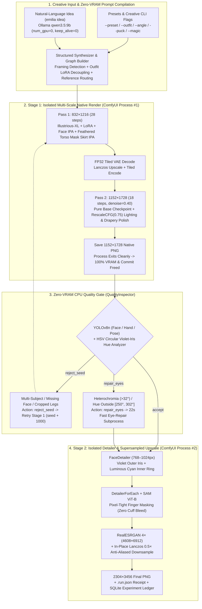
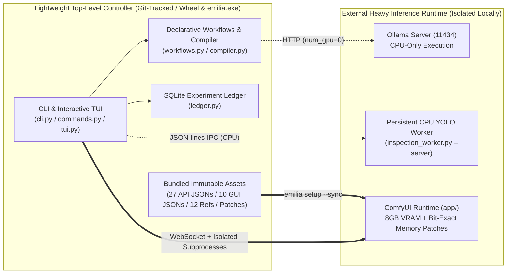

# Emilia Studio (v2.1)

<div align="center">

**[简体中文](README.md) | English**

*A declarative SDXL character artwork compiler, two-stage process-isolated rendering engine, and zero-VRAM quality-gate pipeline built for 8 GiB VRAM GPUs.*

</div>

---

## Overview

**Emilia Studio** is a declarative, memory-disciplined anime illustration pipeline built around **ComfyUI** and **Ollama**. Engineered specifically for **8 GiB VRAM GPUs** (verified on NVIDIA CMP 40HX / Turing CC 7.5) and bounded Windows system commit limits, it produces **2304×3456 official-grade refined character illustrations** without exhausting GPU or host virtual memory.

The top-level controller (`emilia_studio` Python package and standalone `emilia.exe` binary) ships only orchestration code, declarative workflow builders, runtime patches, and reference assets—staying physically decoupled from the external ComfyUI/CUDA inference runtime (`app/`).

---

## Architecture & Execution Pipeline

### 1. End-to-End Two-Stage Isolated Rendering & Self-Healing Loop



### 2. Physical Separation Between Controller & Inference Runtime



---

## Key Technical Highlights

1. **Three-Tier Ultra Multi-Scale Hires.fix & Spatial Garment Decoupling (`emilia_studio/workflows.py`)**
   - **`832×1216` (proportion & anatomy lock) $\to$ `1152×1728` (pure base model + `RescaleCFG` lighting polish) $\to$ `2304×3456` (part-specific detailers + 4× upscale / 0.5× supersampled downsample)**: Eliminates elongated-limb distortion and multi-subject hallucinations inherent to direct high-res SDXL sampling.
   - **Soft-Feathered Torso Mask (`0.42W × 0.34H`)**: Locks the canonical 6-stripe purple bodice and 3-layered petal skirt while preventing sleeve hawk emblems from bleeding onto lower coattails.
   - **Zero-LoRA-Bleed Alternate Costume Routing (`--outfit frozen-bond / nightgown`)**: Automatically sets Stage 1 `lora_strength_base = 0.0` with paired front + 3/4 `IPAdapter Plus Face` conditioning, restoring `lora_strength_finish = 0.28` only in Stage 2 `FaceDetailer` so alternate dresses stay 100% free of default corset bleed.
2. **Two-Stage Process Isolation & Same-Stage Batch Wave Pooling (`emilia_studio/engine.py`)**
   - Stage 1 (`CLIP-ViT-H` + dual `IPAdapter`) and Stage 2 (`YOLOv8n` + `SAM ViT-B` + `RealESRGAN`) exceed 12 GB combined and never co-reside in memory. Stage 1 exits cleanly before Stage 2 reads the native render via zero-copy `[output]` references.
   - `emilia batch` executes all seeds in Wave 1 (Stage 1) $\to$ CPU Quality Gate $\to$ Wave 2 (Stage 2), reducing $2N$ cold model loads to just $2$.
3. **Zero-VRAM (CPU-Only) Anatomy, Pose & Violet-Iris Self-Healing Gate (`emilia_studio/inspector.py`)**
   - Enforces CPU-only inference across `face_yolov8n`, `hand_yolov8n`, and `yolov8n-pose` to reject multi-face hallucinations, missing faces, and kneeling/cropped-foot failures on `full_body` prompts (`reject_seed`).
   - **HSV Circular Hue Analysis**: Measures left/right iris circular mean hue to detect blue/pink heterochromia ($>32^\circ$) or non-violet drift outside $[250^\circ, 302^\circ]$, routing affected frames through a `22s` targeted eye-repair pass (`repair_eyes`) before Stage 2 upscaling.
4. **12 Bit-Exact Hardware-Ceiling Memory & Latency Optimizations (`patches/` & `engine.py`)**
   - **GPU & PCIe Hot Paths**: Cross-step `(ip_k, ip_v)` linear projection cache in `IPAdapter` (eliminating **15,000+** redundant CUDA kernel launches), `[B, S, 1]` broadcast spatial attention mask cache (eliminating `1,960` `F.interpolate` calls and `1280×` `.repeat()` VRAM traffic), `CLIPVision` zero-image uncond embedding cache, per-step `sigma` scalar cache (eliminating **2,484** GPU$\to$CPU sync stalls), and `SAM ViT-B` `meta + mmap + assign` loading (**6.0×** faster, `-750 MiB` peak host commit) + ViT-B feature caching (`-50%` latency).
   - **CPU, Memory & Boot Hot Paths**: 256-row L3-cache-blocked multi-threaded `float32 <-> uint8` quantization (**3.3×** faster, eliminating `382.2 MiB` in `lanczos` and `91.1 MiB` in `SaveImage`), `VAE` destination-buffer writes & `tiled_scale_multidim` feather-mask caching (`-676.8 MiB`), per-tile GPU transfer in `ImageUpscaleWithModel` (`-382.21 MiB`), PyAV-free static PNG `LoadImage` fast path, stage-specific `--whitelist-custom-nodes` + headless `comfy_extras` fast boot (`-17.3s`), `<1ms` exclusive socket bind + log-driven zero-SYN-retry readiness, and background CPU YOLO pre-warming + teardown-overlapped inspection (eliminating the `8.8s` cold gate stall).
   - Verified **100% bit-exact** (identical decoded PNG SHA-256 hashes) across fixed seed `20261027` (`quality` & `ultra` `2304×3456` pipelines) and the 50-render benchmark corpus.

---

## Quick Start

### 1. Installation & Environment Initialization

```powershell
# Install Emilia Studio in editable or wheel mode
python -m pip install -e .

# Initialize user configuration (saved to %APPDATA%\EmiliaStudio\config.toml)
emilia config init --root-dir D:/comfyui --app-dir D:/comfyui/app --python D:/conda-data/envs/comfyui/python.exe

# Sync top-level references, runtime patches, and GUI workflows into app/, then run 22 health checks
emilia setup --sync
emilia doctor

# List or resume-download required and experimental model weights
emilia pull --list
```

*Running `emilia` with no arguments displays the gradient ASCII banner and launches the interactive shell (`help <command>` for usage, `exit` to quit).*

### 2. Render 2304×3456 Illustrations

```powershell
# 1. Built-in scene preset + Ultra multi-scale pipeline + automatic CPU quality gate
emilia render --profile ultra --preset rose-garden --auto-gate

# 2. Creative controls: 5 outfits, camera angles, Puck companion, and ice magic effects
emilia render --profile ultra --preset library --outfit nightgown --angle three-quarter --puck --magic frost --auto-gate

# 3. Compile natural-language prompts via CPU-only Ollama into the 2-stage pipeline
emilia idea "爱蜜莉雅站在飘雪的月光庭院里微笑，双手轻捧冰晶花" --outfit cloak --magic snow --auto-gate

# 4. Same-stage wave batch rendering (zero redundant model reloads across seeds)
emilia batch --seeds 20261113 20261114 20261115 --profile ultra --preset rose-garden --auto-gate

# 5. Reproducible fixed-seed baseline (or via the PowerShell launcher)
.\render-emilia-quality.ps1 -Seed 20261027 -Profile quality
```

### 3. Inspection, Comparison, Export & Ledger

```powershell
# Run standalone CPU-only anatomy, full-body pose, violet-iris, and corner-watermark diagnostics
emilia inspect app/output/emilia/ultra/03_finished_2x_00015_.png --stage final

# Compare resolution, decoded SHA-256, and iris hue metrics across two PNGs or .run.json receipts
emilia compare app/output/emilia/ultra/03_finished_2x_00013_.png app/output/emilia/ultra/03_finished_2x_00015_.png

# Bundle the latest or specified final PNG, native base, receipt, and workflow JSON into a folder
emilia export ./deliverables

# Query SQLite experiment statistics, review benchmarks, and clean completed temp stage folders
emilia ledger stats
emilia benchmark --limit 10
emilia clean --older-than-hours 1.0
```

---

## CLI Command Reference

| Command | Description |
| :--- | :--- |
| `config init / show / set / path` | Initialize, inspect, or update TOML config (`EMILIA_*` env > `--config` > user config > checkout config) |
| `doctor` / `setup --sync` | Validate Python, dependencies, model sizes (`required` / `experimental`), references, and sync into `app/` |
| `pull --list / <key> / all` | Resumable HTTP Range downloader with `.part` staging and SHA-256 verification (prints manual guide for LoRAs) |
| `presets [name]` / `outfits [name]` | Browse 6 zero-Ollama scene presets and 5 Emilia outfits (`royal`, `cloak`, `frozen-bond`, `sanctuary`, `nightgown`) |
| `render` / `batch` / `idea` | Single render, wave-pooled batch render, and Ollama prompt-compiled render (supports `--garment-region`, `--hires-bridge`, etc.) |
| `inspect` / `compare` | CPU-only image diagnostics; side-by-side pixel hash and iris hue comparison |
| `export` / `clean` | Export deliverable bundle; prune finished temporary stage directories |
| `ledger` / `benchmark` / `workflows` | Query SQLite ledger & cross-round parity; summarize benchmarks; audit/sync 27 API & 10 GUI workflows |
| `shell` / `banner` / `--version` | Interactive REPL shell, ASCII banner, and version string |

---

## Repository Structure

```text
.
├── emilia_studio/                 # Standalone top-level controller package (bundled in wheel & emilia.exe)
│   ├── cli.py                     # CLI argument parser and subcommand router
│   ├── commands.py                # config / doctor / pull / presets / outfits / compare / export / clean handlers
│   ├── compiler.py                # CPU-only Ollama compiler & framing/costume prompt synthesizer
│   ├── config.py                  # Auto-discovery, TOML loader & canonical Emilia outfit/scene constants
│   ├── engine.py                  # Two-stage isolated rendering engine & wave-pooled batch runner
│   ├── inspector.py               # CPU-only YOLO anatomy, pose completeness, HSV iris & watermark gate
│   ├── inspection_worker.py       # Persistent JSON-lines external CPU YOLO worker for frozen emilia.exe
│   ├── ledger.py                  # WAL-mode SQLite experiment and benchmark ledger
│   ├── tui.py                     # Gradient ASCII banner, CJK-aware tables, and live progress bar
│   └── workflows.py               # Declarative API graph builder & zero-drift GUI workflow synchronizer
├── assets/                        # 12 official reference conditioning crops (front/3Q face, bodice/skirt, brooch)
├── workflows/                     # Single-source-of-truth workflows & benchmark records
│   ├── api/                       # 27 canonical .api.json execution graphs
│   ├── visual/                    # 10 synchronized ComfyUI visual workflows (Emilia_01..10)
│   ├── reports/                   # Historical ablation, visual review, and hardware benchmark JSON reports
│   └── WORKFLOW_DECISIONS.txt     # Engineering decision log and pixel-hash audit trail
├── patches/                       # Bit-exact memory and hardware-ceiling latency patches
│   ├── emilia_runtime_patches/    # Self-verifying ComfyUI custom_node plugin + EmiliaRelativeGarmentSEGS node
│   ├── comfyui_core.patch         # Git diff for main.py, comfy/sd.py, utils.py, caching.py, execution.py, nodes.py
│   ├── ipadapter_plus.patch       # KV projection, broadcast mask, sigma scalar & zero-uncond cache patch
│   ├── impact_pack.patch          # SAMLoader meta+mmap+assign load & SAMWrapper feature cache patch
│   └── impact_subpack.patch       # Zero-copy bbox mask & quiet inference patch for subcore.py
├── packaging/                     # PyInstaller spec and Windows build script (emilia.spec, build_windows.ps1)
├── tests/                         # 10 standalone test modules (154 tests) + comfy_core/ operator unit tests
├── AGENTS.md                      # Hardware constraints, process isolation rules, and engineering guidelines
├── PROGRESS.md                    # 15-phase engineering ledger and benchmark tables
├── build_support.py               # Build-time immutable resource stager for wheel & PyInstaller
├── config.example.toml            # Portable TOML configuration template
├── models_manifest.json           # 13 required/experimental model weights, references, and pinned node commits
├── ollama_comfyui_bridge.py       # Standalone natural-language bridge script (--mode quality / fast)
├── render-emilia-quality.ps1      # One-click PowerShell two-stage quality launcher
└── start-comfyui.ps1              # Interactive ComfyUI GUI server launcher (default 127.0.0.1:8188)
```

*Note: Local `app/` (ComfyUI runtime and custom nodes) is ignored in `.gitignore` so `app/.git` remains a clean upstream ComfyUI repository.*

---

## Building from Source & Running Tests

```powershell
# Build portable wheel and standalone Windows executable (dist/emilia.exe)
python -m pip install ".[build]"
powershell -NoProfile -ExecutionPolicy Bypass -File packaging/build_windows.ps1 -Python D:/conda-data/envs/comfyui/python.exe

# Run the top-level Emilia Studio unit suite (151 passed)
D:\conda-data\envs\comfyui\python.exe -m pytest tests/

# Run the full ComfyUI runtime & core operator unit suite (151 passed)
D:\conda-data\envs\comfyui\python.exe -m pytest app/tests-unit/comfy_test/
```

---

## License

- **Emilia Studio Controller, Workflows, Patches & Tests (`emilia_studio/`, `workflows/`, `patches/`, `tests/`, `packaging/`)**: [MIT License](LICENSE).
- **External ComfyUI Runtime (`app/`)**: GPL-3.0 License.
- **Model Weights**: Governed by their respective upstream licenses (Illustrious-XL, RealESRGAN, Ultralytics YOLOv8, Segment Anything).
