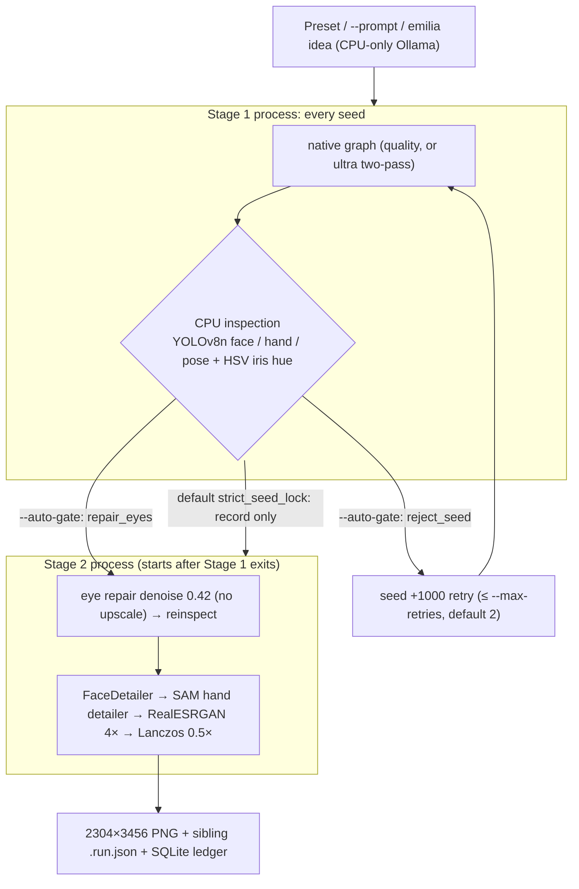

# Emilia Studio (v2.1.0)

<div align="center">

**[简体中文](README.md) | English**

*An Illustrious-XL character illustration pipeline for 8 GiB GPUs: declarative workflow builder, two-process isolated rendering, CPU-only quality gate, and SQLite experiment ledger.*

</div>

---

## Overview

Emilia Studio orchestrates `2304×3456` illustrations of Emilia (Re:Zero) on top of [ComfyUI](https://github.com/Comfy-Org/ComfyUI). The target machine is an **NVIDIA CMP 40HX (8 GiB, Turing CC 7.5) + Xeon E5-2690 v2 with a bounded Windows commit limit**. Every design decision follows one constraint: Stage 1 (checkpoint + IPAdapter + CLIP Vision) and Stage 2 (detailers + YOLO + SAM + upscaler) never share a process.

- The controller `emilia_studio/` (wheel and `emilia.exe`) ships orchestration, the workflow builder, inspection, and assets — no inference dependencies.
- The runtime `app/` is ComfyUI plus three custom nodes at pinned commits, modified by `patches/*.patch`; `emilia doctor` verifies both.
- The same arguments always build the same graph: the builder never rewrites a workflow according to installed files; a missing model fails ComfyUI validation.

---

## Two Profiles

| | `quality` (baseline) | `ultra` (creative) |
| :--- | :--- | :--- |
| Default for | `render`, `benchmark`, `render-emilia-quality.ps1` | `batch`, `idea`, `ollama_comfyui_bridge.py` |
| Stage 1 | Single pass `1152×1728`, 36 steps `dpmpp_2m_sde`/`karras`, CFG 5.5 | Pass 1 `832×1216`, 28 steps `dpmpp_2m_sde`/`karras`, CFG 4.5, `RescaleCFG 0.75` → tiled VAE + Lanczos → Pass 2 `1152×1728`, 18 steps `dpmpp_2m`/`karras`, denoise 0.40 |
| LoRA | `emilia-re-zero-re` 0.80 | `Emilia_Rezero_Q-000005` Pass 1 0.25 / Pass 2 0 (base only) / Stage 2 0.25 |
| IPAdapter | Plus Face 0.40, `linear`, `K+V`, 0–0.75 | Plus Face 0.18, `ease in-out`, `V only`, 0.15–0.60; full/upper body add a torso soft-masked Plus outfit reference at 0.45 |
| Stage 2 | FaceDetailer 640/896, denoise 0.22; SAM hands 512/768, 0.24 | FaceDetailer 768/1024, crop 1.6×, 0.28; SAM hands crop 2.0×, 512/1024, 0.40, soft mask (`noise_mask_feather 8` enables DifferentialDiffusion, mask dilated 12 px) |
| Output | RealESRGAN anime 6B 4× → Lanczos 0.5× = `2304×3456` | same |
| Purpose | Fixed-seed bit-exact baseline (hashes below) | Scene presets, 5 outfits, angles, Puck, ice magic |

`--fast` (both profiles): FP16 RealESRGAN + `sdxl-vae-fp16-fix` + single-pass tiled VAE; `quality` 32 native steps, `ultra` 24 Pass 1 steps, 16 hand steps. Pixels no longer match the baseline.

`--preview`: the official ByteDance [SDXL-Lightning](https://huggingface.co/ByteDance/SDXL-Lightning) 8-step standalone UNet, `832×1216`, Euler/`sgm_uniform`/CFG 1, reusing only the checkpoint's CLIP/VAE — no LoRA, IPAdapter, or Stage 2. It is a text-only composition draft without identity guarantees; negative prompts have no effect at CFG 1.

---

## Pipeline



- $N$ seeds cost exactly $2$ ComfyUI cold starts; Stage 2 reads Stage 1 outputs through `[output]` references without upload or copy.
- Each seed gets its receipt and ledger row the moment it finishes or is rejected; a later crash never loses earlier results.
- Each graph has a total deadline `stage_timeout_s=900` and a current-prompt event silence deadline `stall_timeout_s=300`; a timeout stops only the child process Emilia started.
- Headless `SaveImage` uses PNG compression 0 for `01_`/`02_`/`eye_repair_` prefixes, 1 for other headless outputs, 4 in the GUI; only file size changes.

---

## Quality Gate

`QualityInspector` runs `face_yolov8n`, `hand_yolov8n`, and `yolov8n-pose` on the CPU and never touches VRAM.

| Check | Action | Active when |
| :--- | :--- | :--- |
| No face, or several faces on a solo prompt | `reject_seed` | `--auto-gate` |
| Seated/kneeling/cropped full body (face ratio > 0.165, ankle confidence < 0.30, hip y > 0.60, ankle y < 0.68; in face heights: < 3.05 below the hips, or < 6.3 tall with shin drop ≥ 1.6 × thigh drop, or < 5 tall with unreliable hips) | `reject_seed` | `ultra` + `full_body` + `--auto-gate`; or `inspect --require-full-body-pose` |
| Iris hue difference > 32°, or an eye outside `[250°, 302°]` | `repair_eyes` | `--auto-gate` |
| Garment colors, corner watermark stroke density | recorded only | never changes the flow |

- Iris localization prefers COCO eye keypoints from the same CPU pass and falls back to a face-geometry prior; candidates are extracted from a ≤ `384×384` working image, hue is measured on original pixels.
- An eye with fewer than 8 iris pixels is unmeasured (`eye_color_verified=false`): neither verified violet nor repaired.
- Limits: COCO keypoints are not an anime face/body model; ornaments, occlusion, tiny or warm irises may stay ambiguous. The pose gate uses the face-containing person box with the best-supported leg keypoints; a figure lying flat seen from above has a standing 2D skeleton and is not detected (the negative prompt handles it); a standing figure shot from above can be rejected, costing one reseed.
- A repaired native is reinspected and never upscaled after a failed gate. Without `--auto-gate` every finding is recorded but execution and pixels are unchanged.

---

## Quick Start

### 1. Install

```powershell
python -m pip install -e .
emilia config init --root-dir <workspace> --app-dir <workspace>/app --python <inference-env>/python.exe

# First deployment: check out the commits pinned in models_manifest.json and apply the patches
git -C app checkout 0a33ed6c28f926d14536235771c222f9e6d1026b
git -C app apply ../patches/comfyui_core.patch
git -C app/custom_nodes/comfyui-ipadapter-plus apply ../../../patches/ipadapter_plus.patch
git -C app/custom_nodes/comfyui-impact-pack apply ../../../patches/impact_pack.patch
git -C app/custom_nodes/comfyui-impact-subpack apply ../../../patches/impact_subpack.patch

emilia setup --sync     # references, patch plugin, workflows and runtime tests into app/
emilia doctor           # dependencies, models, commits and patch state
emilia pull --list      # resumable, SHA-256 verified; the two Emilia LoRAs have no public URL and must be placed manually
```

Running `emilia` without arguments opens the interactive shell (`help <command>`, `exit`).

### 2. Render

```powershell
# Creative profile: built-in scene + automatic gate
emilia render --profile ultra --preset rose-garden --auto-gate

# Outfit / angle / Puck / ice magic
emilia render --profile ultra --preset moonlit-balcony --outfit nightgown --angle three-quarter --puck --magic ice --auto-gate

# Chinese idea compiled by CPU-only Ollama
emilia idea "爱蜜莉雅站在飘雪的月光庭院里微笑，双手轻捧冰晶花" --outfit cloak --magic blizzard --auto-gate

# Batch: every seed shares one Stage 1 and one Stage 2 process
emilia batch --profile ultra --preset rose-garden --seed 20261027 --count 4 --auto-gate

# Baseline reproduction (bit-exact with the hashes below)
.\render-emilia-quality.ps1 -Seed 20261027 -Profile quality

# Acceleration / composition draft
emilia render --profile quality --seed 20261027 --fast
emilia pull sdxl-lightning-8step-unet; emilia render --profile ultra --preset rose-garden --preview
```

Exit codes: `0` success; `2` rejected by the gate (any seed of a batch); `1` failure; `130` interrupted.

### 3. Inspect and archive

```powershell
emilia inspect app/output/emilia/ultra/03_finished_2x_00015_.png --stage final --require-full-body-pose
emilia compare <a.png|a.run.json> <b.png|b.run.json> [--json]
emilia gallery --limit 10 [--open 1]
emilia export ./deliverables [--image <png|run.json>]
emilia ledger stats | recent | compare --round-a 1 --round-b 5 | ingest --refresh
emilia benchmark --limit 10 [--run --profile quality --seed 20261027]
emilia clean --older-than-hours 1 [--dry-run]     # a running render holds a file lock and is never removed
```

---

## CLI Reference

### Commands

| Command | Description |
| :--- | :--- |
| `render` | One seed through both stages (default `quality`). `--seed` defaults to the preset seed or `20261027` |
| `batch` | Several seeds (default `ultra`). `--seeds A B C`, or `--seed S --count N` (default 2) |
| `idea` | Chinese idea → Ollama → render (default `ultra`, random seed). `--style anime\|illustration\|cinematic` |
| `inspect` | CPU inspection of one image. `--stage native\|final`, `--framing`, `--require-full-body-pose` |
| `compare` / `gallery` / `export` | Side-by-side metrics; recent outputs; bundle with native, receipt and embedded workflow |
| `ledger` / `benchmark` | `ingest\|stats\|recent\|compare`; timing summary or one live run |
| `workflows` | Verifies the 5 default builder calls equal their canonical graphs (exit `2` on drift); `--sync-visual` rewrites GUI workflows |
| `setup` / `doctor` / `pull` | Manifest check and `--sync`; environment check; model download |
| `config init\|show\|set\|path` | TOML configuration. `set` accepts path keys and `comfy_host`, `comfy_port`, `quality_port`, `ollama_base`, `ollama_model` |
| `presets` / `outfits` | 6 scene presets; 5 outfits (`--framing` previews the prompt) |
| `clean` / `shell` / `banner` | Temp cleanup; interactive shell; banner |

### Render options (`render` / `batch` / `idea`)

| Option | Description |
| :--- | :--- |
| `--profile quality\|ultra` | Profile |
| `--preset NAME` / `--prompt TEXT` | Scene preset or custom positive prompt (mutually exclusive; not on `idea`) |
| `--auto-gate` / `--max-retries N` | Gate, seed retry and eye repair; retry limit defaults to 2 |
| `--pag` | `PerturbedAttentionGuidance`, scale 1.0 on `quality` and 0.8 on `ultra`; one extra UNet pass per step |
| `--port N` | Stage server port (default: configured `quality_port`, 8199) |
| `--steps` / `--face-steps` / `--hand-steps` | Step overrides |
| `--fast` / `--fp16-upscaler` / `--fp16-vae` / `--fast-tiled-vae` | Accelerations (not bit-exact) |
| `--preview` | Lightning 8-step text-only draft; conflicts with `--fast`, `--pag` and Stage 2 options |
| `--outfit` `--angle` `--puck` `--magic` | `ultra` only: `royal\|cloak\|frozen-bond\|sanctuary\|nightgown`; `auto\|front\|three-quarter\|side\|high-angle\|low-angle`; `none\|ice\|blizzard` |
| `--reference-mode single\|paired` | `ultra` only: one face, or averaged front + three-quarter embeddings |
| `--hires-bridge lanczos\|anime` | `ultra` only: Pass 1→2 pixel bridge |
| `--checkpoint` `--garment-region` `--upscaler` `--secondary-upscaler` `--upscale-blend` | `ultra` only: checkpoint override; brooch/bodice/full-garment geometry-prior detailer; primary/secondary upscaler and blend |

`render` and `batch` reject creative/ultra options on the `quality` profile.

---

## Configuration

Precedence: `EMILIA_*` environment > `--config` / `EMILIA_CONFIG_TOML` > user config (`%APPDATA%\EmiliaStudio\config.toml`, directory overridable via `EMILIA_CONFIG_DIR`) > checkout `config.toml`. Relative TOML paths resolve beside that file. See [`config.example.toml`](config.example.toml) for the template and every environment variable.

| Section | Keys |
| :--- | :--- |
| `[paths]` | `root_dir` `app_dir` `output_dir` `temp_dir` `workflows_dir` `visual_workflows_dir` `conda_python` `ollama_exe` `resources_dir` |
| `[services]` | `comfy_host` `comfy_port` `quality_port` `ollama_base` `ollama_model` `stage_timeout_s` `stall_timeout_s` (≤0 disables) |
| `[models]` | `ultra_lora_name` (missing file fails; no fallback) |

---

## Reproducibility Baseline

Seed `20261027`, `pag=False`, no `--auto-gate`; decoded-pixel SHA-256 (`hashlib.sha256(Image.open(p).tobytes())`):

| Profile | Native | Final |
| :--- | :--- | :--- |
| `quality` | `3b58d9daf2770d0ad7e87b971912b854e1e7495f9e99a09f348af9bf258c9425` | `d7fe10c200535d8656ab633248ca7cc651ee6d2e60bd309c23c43fa1ce5af63e` |
| `quality --fast` | — | `a97a5cbff467816b53049c710b88c1f25ce7ed58b49c0d5c342b572fd6db3f9d` |

If a hash differs, rule out the hardware first: `python gpu_profile.py status` shows clock offsets; `gpu_profile.py reset` (elevated) removes them for a control run. `ultra` hashes and their history are in [PROGRESS.md](PROGRESS.md).

---

## Tuning Rationale (community docs checked against local source)

- **CLIP skip**: ComfyUI's `SDXLClipModel` (`app/comfy/sdxl_clip.py`) already takes the penultimate layer of both `clip_l` and `clip_g` (WebUI CLIP Skip 2), matching Illustrious-XL training. Graphs contain no `CLIPSetLastLayer`.
- **Quality tags**: the Illustrious-XL v0.1 [model card](https://huggingface.co/OnomaAIResearch/Illustrious-xl-early-release-v0) and [technical report](https://arxiv.org/abs/2409.19946) list `worst/bad/average/good/best quality`, `masterpiece`, and year tags such as `newest`; recommended Euler a, 20–28 steps, CFG 5–7.5. v0.1 was trained on comma-separated Danbooru tags only and handles long prose poorly; CLIP behaves close to a bag of words, so adjacent words such as `purple border` or `hawk` activate the matching Danbooru concepts (frame border, bird).
- **RescaleCFG vs PAG**: at runtime `RescaleCFG` (`sampler_cfg_function`) runs before PAG (`sampler_post_cfg_function`) regardless of node order; PAG's term bypasses RescaleCFG's variance damping, so its scale must stay conservative.
- **IPAdapter** ([cubiq](https://github.com/cubiq/ComfyUI_IPAdapter_plus)): `V only` scales the attention output without changing the attention distribution; `ease in-out` weights transformer layers and is not a time schedule — `start_at/end_at` are. With one reference image `combine_embeds` has no effect.
- **Detailers** ([Impact Pack](https://github.com/ltdrdata/ComfyUI-Impact-Pack)): with `guide_size_for=bbox` the crop is scaled by `guide_size / min(bbox)` and then clamped by `max_size`, so a large `crop_factor` leaves far fewer face/hand pixels than `guide_size`; `feather` affects only paste-back, while `noise_mask_feather > 0` softens the sampling mask and enables `DifferentialDiffusion` automatically (still loaded under headless fast boot).
- **Prompt hygiene (Phase 19)**: the `ultra` outfit text now says `thin purple hem trim` and `yellow emblem`, the negative bans `border, purple border, framed`, `rose-garden` adds `outdoors, blue sky`, and the negative keeps `sitting, kneeling, lying, on back` only when the scene mentions standing or walking (the compiler removes them for any other scene). Seed `20261027` changed from "purple frame + yellow bird + lying, seen from above" to a standing full body; seated/kneeling seeds still occur and `--auto-gate` catches only some of them.

---

## Lossless Optimizations

All verified to keep decoded pixels unchanged on the fixed seed and the historical 50-image benchmark.

- **IPAdapter** (`ipadapter_plus.patch`): cross-step `(ip_k, ip_v)` projection cache, `[B,S,1]` broadcast spatial mask, zero-image negative CLIP Vision embedding, per-step `sigma` scalar.
- **VAE / quantization / upscaler** (`comfyui_core.patch`, 7 files): VAE destination writes and tiled accumulation, `tiled_scale_multidim` mask reuse, 256-row blocked `float32↔uint8`, per-tile GPU transfer in `ImageUpscaleWithModel`, PyAV-free static PNG load, storage-deduplicated `RAMPressureCache` accounting, Windows `PrefetchVirtualMemory` sequential prefetch.
- **SAM / detection** (`impact_pack.patch`, `impact_subpack.patch`): `meta + mmap + assign` loading, feature cache, no GPU transfer for zero detections, no redundant grayscale copies.
- **Boot & orchestration** (`engine.py`, `inspector.py`, `app/main.py`, `app/nodes.py`): per-stage custom-node whitelists, only 13 essential `comfy_extras`, `<1 ms` exclusive port check and log-driven readiness, CPU YOLO warm-up and Stage 2 weight read-ahead during Stage 1 sampling, inspection overlapped with process teardown.

---

## Repository Layout

```text
emilia_studio/       controller: cli / commands / tui / config / _version / workflows / compiler / engine / inspector / inspection_worker / ledger
workflows/api/       29 .api.json: 5 canonical graphs (builder-verified), emilia_lora_native template, 23 historical experiments
workflows/visual/    Emilia_01..10 GUI workflows (08–10 rewritten by workflows --sync-visual)
workflows/reports/   ablation, image-quality and hardware reports; WORKFLOW_DECISIONS.txt is the decision record
patches/             4 git patches + emilia_runtime_patches (EmiliaRelativeGarmentSEGS, EmiliaCheckpointConditioning, source-signature checks)
assets/              official_face_center_clean.png + 10 design crops in official_references/
scripts/             10-seed benchmark runner/evaluator, shared PowerShell interpreter resolver
tests/               9 top-level modules + 4 operator modules in comfy_core/
packaging/           PyInstaller spec and Windows build script
render-emilia-quality.ps1 · start-comfyui.ps1 · ollama_comfyui_bridge.py · gpu_profile.py · install-gpu-profile-task.ps1
config.example.toml · models_manifest.json (11 required + 4 experimental models, references, pinned commits and patches)
```

`app/` is ignored by Git. It is not a clean upstream checkout; upgrading ComfyUI or a custom node requires regenerating its patch.

### Optional GPU scheduled task

`install-gpu-profile-task.ps1` stages a protected, versioned Python/pynvml copy under `%ProgramData%\EmiliaGPUProfile\versions\`, runs it with `-I -S`, and audits the ACLs of everything it executes before registering.

```powershell
.\install-gpu-profile-task.ps1 -Python D:\conda-data\envs\comfyui\python.exe   # elevated
.\install-gpu-profile-task.ps1 -Audit                                           # unelevated
.\install-gpu-profile-task.ps1 -Remove                                          # elevated
```

Reinstall after editing the repository script to update the SYSTEM copy. `-AllowUserWritable` is an insecure opt-out and still fails the audit.

---

## Build & Test

```powershell
python -m pip install ".[build]"
powershell -NoProfile -ExecutionPolicy Bypass -File packaging/build_windows.ps1 -Python <inference-env>/python.exe

python -m pytest tests/                        # no GPU needed; cases needing app/ or torch skip themselves
python -m pytest app/tests-unit/comfy_test/    # inference environment, after setup --sync
```

## License

- Controller, workflows, patches and tests: [MIT](LICENSE).
- `app/` (ComfyUI): GPL-3.0.
- Model weights: their upstream licenses (Illustrious-XL under fair-ai-public-license-1.0-sd, RealESRGAN, Ultralytics YOLOv8, Segment Anything, SDXL-Lightning, …).
