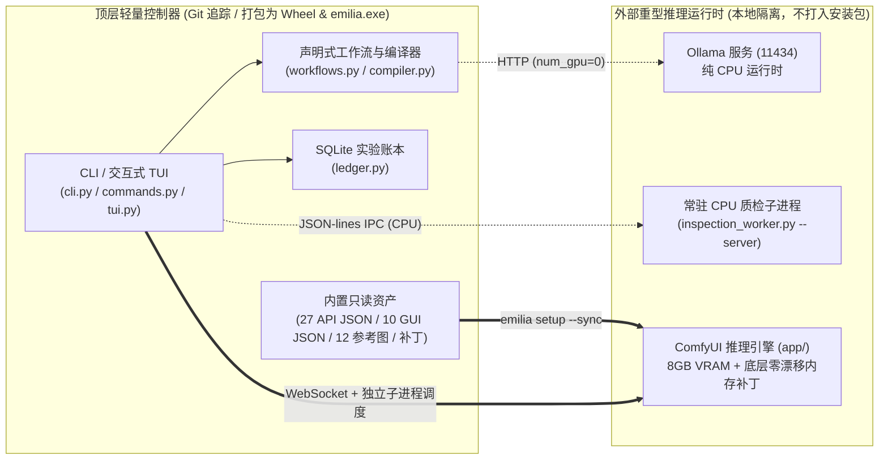

# Emilia Studio (v2.1)

<div align="center">

**简体中文 | [English](README.en.md)**

*专为 8 GiB 显存显卡打造的声明式 SDXL 角色精修编译器、双阶段物理隔离引擎与零显存质检自愈管线。*

</div>

---

## 项目简介

**Emilia Studio** 是一套围绕 **ComfyUI** 与 **Ollama** 从零构建的声明式、内存严苛受控的高分辨率动漫插画生成系统。项目针对 **8 GiB 显存显卡**（已在 NVIDIA CMP 40HX / Turing CC 7.5 上完整验证）与受限的 Windows 系统提交内存（Commit Limit）进行逐行热路径优化，稳定直出 **2304×3456 官图级精修角色插画**。

顶层控制器（`emilia_studio` Python 包及独立编译版 `emilia.exe`）仅包含调度逻辑、工作流构建器与参考图资产，与底层庞大的 ComfyUI/CUDA 推理环境（`app/`）完全物理隔离。

---

## 全局架构与运行管线

### 1. 端到端双阶段隔离渲染与自愈闭环


### 2. 控制器与外部推理环境物理隔离拓扑



---

## 核心技术特性

1. **三段式 Ultra 多尺度架构与服饰空间解耦（`emilia_studio/workflows.py`）**
   - **`832×1216`（锁骨骼与设定）$\to$ `1152×1728`（纯底模 + `RescaleCFG` 锁光影）$\to$ `2304×3456`（分部位精修 + 4× 超分 0.5× 抗锯齿降采样）**：彻底根除 SDXL 直接生成高分辨率全身图常见的“长腿畸变”与“多肢体幻觉”。
   - **躯干软边空间掩码（`0.42W × 0.34H`）**：精准锁定王选礼服的“六道紫纹束腰 + 三层花瓣裙”，杜绝袖口金鹰纹章串色到下摆燕尾。
   - **非官设服装零串色路由（`--outfit frozen-bond / nightgown`）**：Stage 1 自动将 `lora_strength_base` 降至 `0.0` 并切换双角度正面/3/4侧面 `IPAdapter Plus Face` 锁脸，仅在 Stage 2 修脸时恢复 `lora_strength_finish=0.28`，彻底消除默认礼服束腰残留。
2. **面向 8 GiB 显存的双阶段进程物理隔离与批量复用池（`emilia_studio/engine.py`）**
   - Stage 1（`CLIP-ViT-H` + 双 `IPAdapter`）与 Stage 2（`YOLO` + `SAM ViT-B` + `RealESRGAN`）总权重超过 12 GB，严禁同进程驻留。Stage 1 落盘后子进程立即退出清空显存与 Windows 提交内存，Stage 2 通过 `[output]` 零拷贝引用直接接力。
   - 批量连抽（`emilia batch`）采用“全批次 Stage 1 波次 $\to$ 全批次 CPU 质检门禁 $\to$ 全批次 Stage 2 波次”，将 $2N$ 次冷启动压缩为 $2$ 次。
3. **零显存（纯 CPU）解剖学、站姿与紫罗兰虹膜自愈门禁（`emilia_studio/inspector.py`）**
   - 强制在 CPU 上运行 `face_yolov8n`、`hand_yolov8n` 与 `yolov8n-pose`：自动拦截单人多脸幻觉、缺脸，以及全身构图（`full_body`）下的跪坐/裁脚缺陷（`reject_seed`）。
   - **HSV 虹膜环形色相分析**：计算双瞳环形均值色相角，精准捕捉“一蓝一粉异色瞳”（色差 $>32^\circ$）或偏离紫罗兰色带（$[250^\circ, 302^\circ]$）的漂移，自动路由至仅需 `22 秒` 的修眼分支（`repair_eyes`）完成自愈。
4. **8 项 Bit-Exact 像素级零漂移底层内存补丁（`patches/`）**
   - 涵盖 `VAE` 目标缓冲区直写、`tiled_scale_multidim` 分块羽化掩码复用（单次省去 `676.8 MiB` 分配抖动）、`SaveImage` 原位 `np.clip`（省 `91.1 MiB`）、原位 `lanczos` 缩放（省 `692.75 MiB`）、`ImageUpscaleWithModel` 按分块上 GPU（省 `382.21 MiB` CPU 提交内存）、IPAdapter `sigma` 标量缓存（消除 **2,484 次** GPU$\to$CPU 同步停顿）、`SAM` 特征缓存（推理提速 50%）及 `RAMPressureCache` 字典张量统计修复。
   - 经 **5 轮 × 10 固定种子（50 张 `2304×3456` 全流程大图）** 验证，解码像素 SHA-256 与基线 **100% 逐字节一致**。

---

## 快速开始

### 1. 安装与初始化环境

```powershell
# 在推理或控制环境中安装 Emilia Studio
python -m pip install -e .

# 初始化用户配置（保存至 %APPDATA%\EmiliaStudio\config.toml）
emilia config init --root-dir D:/comfyui --app-dir D:/comfyui/app --python D:/conda-data/envs/comfyui/python.exe

# 将顶层参考图、补丁插件与可视化工作流同步至 app/，并执行 22 项环境体检
emilia setup --sync
emilia doctor

# 按需查看或断点续传下载缺失模型（支持 required 与 experimental 模型分级）
emilia pull --list
```

*无参数直接运行 `emilia` 将展示渐变 ASCII 欢迎页并进入交互式命令终端（支持输入 `help <子命令>` 查看详情，`exit` 退出）。*

### 2. 生成 2304×3456 精修插画

```powershell
# 1. 使用内置场景预设 + Ultra 多尺度精修 + 自动质检门禁
emilia render --profile ultra --preset rose-garden --auto-gate

# 2. 组合创意参数：5 套专属服装 / 视角锁定 / 帕克伴随 / 冰魔法特效
emilia render --profile ultra --preset library --outfit nightgown --angle three-quarter --puck --magic frost --auto-gate

# 3. 中文自然语言一键编译并直通双阶段高分管线（Ollama 纯 CPU 编译）
emilia idea "爱蜜莉雅站在飘雪的月光庭院里微笑，双手轻捧冰晶花" --outfit cloak --magic snow --auto-gate

# 4. 多图同阶段进程池连抽（模型零重复加载）
emilia batch --seeds 20261113 20261114 20261115 --profile ultra --preset rose-garden --auto-gate

# 5. 固定种子像素一致性基准复现（或使用 PowerShell 快捷脚本）
.\render-emilia-quality.ps1 -Seed 20261027 -Profile quality
```

### 3. 质检对比、成品导出与实验账本

```powershell
# 对任意图像执行纯 CPU 解剖学、全身姿态、紫瞳色相与四角水印体检
emilia inspect app/output/emilia/ultra/03_finished_2x_00015_.png --stage final

# 对比两张成品 PNG 或 .run.json 回执的 SHA-256、双瞳色相角与异色瞳评分
emilia compare app/output/emilia/ultra/03_finished_2x_00013_.png app/output/emilia/ultra/03_finished_2x_00015_.png

# 将最新成品图、阶段一母版、回执与工作流打包导出至指定目录
emilia export ./deliverables

# 查询 SQLite 实验账本历史统计与基准耗时，清理 temp/ 阶段临时目录
emilia ledger stats
emilia benchmark --limit 10
emilia clean --older-than-hours 1.0
```

---

## CLI 命令速查表

| 子命令 | 功能说明 |
| :--- | :--- |
| `config init / show / set / path` | 初始化、查看或修改 TOML 配置（优先级：`EMILIA_*` 环境变量 > `--config` > 用户全局配置 > 源码目录配置） |
| `doctor` / `setup --sync` | 校验 Python、依赖、模型权重（`required` / `experimental`）、参考图与插件；将资产与补丁同步至 `app/` |
| `pull --list / <key> / all` | 支持 HTTP Range 断点续传、`.part` 原子替换与 SHA-256 校验的模型下载器（未知源的 LoRA 打印手动指引） |
| `presets [name]` / `outfits [name]` | 浏览 6 套免 Ollama 内置场景预设与 5 套专属服装模式（`royal` / `cloak` / `frozen-bond` / `sanctuary` / `nightgown`） |
| `render` / `batch` / `idea` | 单张渲染、同阶段进程池批量连抽、中文自然语言编译渲染（均支持 `--garment-region`、`--hires-bridge` 等底层参数） |
| `inspect` / `compare` | 纯 CPU 单图全面体检；双图分辨率、像素哈希与双瞳色相指标并排对比 |
| `export` / `clean` | 打包导出完整交付物；安全清理已结束的隔离阶段临时目录 |
| `ledger` / `benchmark` / `workflows` | 查询 SQLite 实验账本与跨轮次像素比对；汇总历史基准；审计并同步 27 个 API 与 10 个 GUI 工作流 |
| `shell` / `banner` / `--version` | 启动交互式 REPL 命令行、打印终端标志或查看版本号 |

---

## 仓库目录结构

```text
.
├── emilia_studio/                 # 顶层独立 Studio 核心包（打包进 Wheel 与 emilia.exe）
│   ├── cli.py                     # CLI 参数解析与全子命令路由入口
│   ├── commands.py                # config / doctor / pull / presets / outfits / compare / export / clean 实现
│   ├── compiler.py                # Ollama 中文转 SDXL 编译器与构图/服饰正负词合成器
│   ├── config.py                  # 环境自发现、TOML 配置加载与爱蜜莉雅服装/场景常量库
│   ├── engine.py                  # 双阶段物理隔离渲染引擎与同阶段批量复用进程池
│   ├── inspector.py               # 纯 CPU 解剖学、姿态完整性、HSV 紫瞳色相与水印诊断门禁
│   ├── inspection_worker.py       # 供独立 exe 调用的常驻 JSON-lines 外部 CPU YOLO 服务进程
│   ├── ledger.py                  # WAL 模式 SQLite 实验与基准账本管理
│   ├── tui.py                     # 渐变 ASCII 标志、CJK 宽字符对齐表格与实时进度条
│   └── workflows.py               # 声明式 API 图构建器与 GUI 工作流零漂移同步器
├── assets/                        # 官方设定条件控制参考图（正面/3/4脸、胸衣裙摆、领口胸针等 12 张）
├── workflows/                     # 单一事实来源工作流与实验档案
│   ├── api/                       # 27 个标准 .api.json 执行图定义
│   ├── visual/                    # 10 个同步后的 ComfyUI 网页端可视化工作流 (Emilia_01..10)
│   ├── reports/                   # 历史架构消融、画质评估与硬件解锁实验报告 JSON
│   └── WORKFLOW_DECISIONS.txt     # 完整工程决策与像素哈希演进档案
├── patches/                       # 底层零漂移内存与耗时优化补丁
│   ├── emilia_runtime_patches/    # 自校验 ComfyUI Custom Node 运行时热补丁 + EmiliaRelativeGarmentSEGS 节点
│   ├── comfyui_core.patch         # 针对 comfy/sd.py, utils.py, caching.py, execution.py, nodes.py 的补丁
│   ├── ipadapter_plus.patch       # 针对 CrossAttentionPatch.py 的 sigma 缓存与免拷贝补丁
│   └── impact_pack.patch          # 针对 SAMWrapper 的图像特征缓存补丁
├── packaging/                     # PyInstaller 独立 Windows 可执行文件构建脚本与规范 (emilia.spec)
├── tests/                         # 10 个顶层单测模块 (151 项测试) 及 comfy_core/ 底层算子测试
├── AGENTS.md                      # 硬件红线、进程隔离规则与像素一致性工程规范
├── PROGRESS.md                    # 14 阶段完整研发里程碑与实测数据台账
├── build_support.py               # Wheel 与 PyInstaller 构建期只读资源自动归集器
├── config.example.toml            # 可移植 TOML 配置模板
├── models_manifest.json           # 13 个必需/可选模型权重、参考图与插件 Commit 清单
├── ollama_comfyui_bridge.py       # 轻量中文自然语言生图桥接脚本 (--mode quality / fast)
├── render-emilia-quality.ps1      # PowerShell 一键双阶段高画质渲染启动器
└── start-comfyui.ps1              # PowerShell ComfyUI 网页端 GUI 启动器 (默认 127.0.0.1:8188)
```

*注：本地 `app/`（ComfyUI 运行时与自定义节点）在 `.gitignore` 中整目录忽略，确保上游 `app/.git` 始终保持干净可升级。*

---

## 从源码构建与运行测试

```powershell
# 构建跨目录可移植 Wheel 包与独立 Windows 控制台程序 (dist/emilia.exe)
python -m pip install ".[build]"
powershell -NoProfile -ExecutionPolicy Bypass -File packaging/build_windows.ps1 -Python D:/conda-data/envs/comfyui/python.exe

# 运行顶层 Emilia Studio 全量单元测试 (151 passed)
D:\conda-data\envs\comfyui\python.exe -m pytest tests/

# 运行 ComfyUI 运行时底层算子与全量单元测试 (151 passed)
D:\conda-data\envs\comfyui\python.exe -m pytest app/tests-unit/comfy_test/
```

---

## 开源协议

- **Emilia Studio 控制器、工作流、补丁与测试（`emilia_studio/`, `workflows/`, `patches/`, `tests/`, `packaging/`）**：[MIT License](LICENSE)。
- **外部 ComfyUI 运行时（`app/`）**：GPL-3.0 License。
- **预训练模型权重**：遵循各上游模型发布协议（Illustrious-XL、RealESRGAN、Ultralytics YOLOv8、Segment Anything）。
