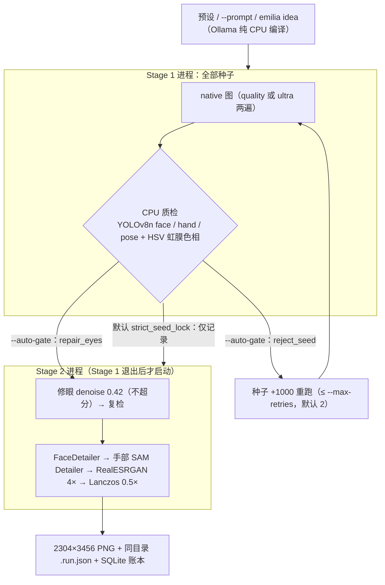

# Emilia Studio (v2.1.0)

<div align="center">

**简体中文 | [English](README.en.md)**

*面向 8 GiB 显存显卡的 Illustrious-XL 角色插画管线：声明式工作流构建器、双进程隔离渲染、纯 CPU 质检门禁与 SQLite 实验账本。*

</div>

---

## 项目简介

Emilia Studio 在 [ComfyUI](https://github.com/Comfy-Org/ComfyUI) 之上编排《Re:Zero》爱蜜莉雅的 `2304×3456` 插画生成。目标机器是 **NVIDIA CMP 40HX（8 GiB，Turing CC 7.5）+ Xeon E5-2690 v2 + 受限的 Windows 提交内存**，所有设计都围绕一条约束：Stage 1（底模 + IPAdapter + CLIP Vision）与 Stage 2（Detailer + YOLO + SAM + 超分）不能同时驻留在同一个进程里。

- 顶层控制器 `emilia_studio/`（Wheel 与 `emilia.exe`）只含调度、工作流构建器、质检与资产，不含推理依赖。
- 推理运行时 `app/` 是固定 commit 的 ComfyUI 与三个自定义节点，外加 `patches/*.patch` 中的源码补丁；`emilia doctor` 校验二者。
- 同一参数永远构建同一张图：构建器从不根据本机装了哪些模型改写工作流，缺模型由 ComfyUI 校验报错。

---

## 两个渲染档位

| | `quality`（基准档） | `ultra`（创作档） |
| :--- | :--- | :--- |
| 默认用于 | `render`、`benchmark`、`render-emilia-quality.ps1` | `batch`、`idea`、`ollama_comfyui_bridge.py` |
| Stage 1 | 单遍 `1152×1728`，36 步 `dpmpp_2m_sde`/`karras`，CFG 5.5 | Pass 1 `832×1216`，28 步 `dpmpp_2m_sde`/`karras`，CFG 4.5，`RescaleCFG 0.75` → 分块 VAE + Lanczos → Pass 2 `1152×1728`，18 步 `dpmpp_2m`/`karras`，denoise 0.40 |
| LoRA | `emilia-re-zero-re` 0.80 | `Emilia_Rezero_Q-000005` Pass 1 0.25 / Pass 2 0（纯底模） / Stage 2 0.25 |
| IPAdapter | Plus Face 0.40，`linear`，`K+V`，0–0.75 | Plus Face 0.18，`ease in-out`，`V only`，0.15–0.60；全身/半身另加躯干软掩码 Plus 服装参考 0.45 |
| Stage 2 | FaceDetailer 640/896，denoise 0.22；手部 SAM 512/768，0.24 | FaceDetailer 768/1024、裁剪 1.6×，0.28；手部 SAM 裁剪 2.0×、512/1024，0.40，软掩码（`noise_mask_feather 8` 启用 DifferentialDiffusion，掩码外扩 12 px） |
| 输出 | RealESRGAN anime 6B 4× → Lanczos 0.5× = `2304×3456` | 同左 |
| 用途 | 固定种子逐像素复现基线（哈希见下） | 场景预设、5 套服装、视角、帕克、冰魔法 |

`--fast`（两档均可）：FP16 RealESRGAN + `sdxl-vae-fp16-fix` + 单遍分块 VAE；`quality` 原生 32 步，`ultra` Pass 1 24 步，手部 16 步。像素不再与基线一致。

`--preview`：ByteDance 官方 [SDXL-Lightning](https://huggingface.co/ByteDance/SDXL-Lightning) 8 步独立 UNet，`832×1216`，Euler/`sgm_uniform`/CFG 1，只借用检查点的 CLIP/VAE，不加载 LoRA、IPAdapter 和 Stage 2。它是纯文本构图草稿，不保证人物身份，CFG 1 下负面提示无效。

---

## 管线



- $N$ 个种子只冷启动 $2$ 个 ComfyUI 进程；Stage 1 落盘后 Stage 2 用 `[output]` 引用直接读取，不上传、不复制。
- 每个种子在完成或被拒的那一刻写回执并入账本；后续种子崩溃不影响已有结果。
- 每张图有总期限 `stage_timeout_s=900` 与当前任务事件静默期限 `stall_timeout_s=300`；超时回收自己启动的子进程，从不停止端口上已有的外部服务。
- 无界面 `SaveImage` 对 `01_`/`02_`/`eye_repair_` 前缀用 PNG 压缩级别 0，其余无界面输出级别 1，GUI 保持 4；只影响文件大小。

---

## 质检门禁

`QualityInspector` 在 CPU 上运行 `face_yolov8n`、`hand_yolov8n`、`yolov8n-pose`，从不占显存。

| 检查 | 判定 | 生效条件 |
| :--- | :--- | :--- |
| 无脸，或单人提示词出现多张脸 | `reject_seed` | `--auto-gate` |
| 全身构图跪坐/坐姿/裁脚（脸高比 > 0.165、脚踝置信 < 0.30、髋 y > 0.60、脚踝 y < 0.68；以脸高为单位：髋以下 < 3.05、或身高 < 6.3 且小腿下垂/大腿下垂 ≥ 1.6、或髋点不可靠且身高 < 5） | `reject_seed` | `ultra` + `full_body` + `--auto-gate`；或 `inspect --require-full-body-pose` |
| 双眼色相差 > 32° 或任一眼不在 `[250°, 302°]` | `repair_eyes` | `--auto-gate` |
| 服装颜色、四角水印笔画密度 | 仅记录 | 永不改变流程 |

- 虹膜定位优先使用同一次 CPU 推理得到的 COCO 眼部关键点，不可靠时退回人脸几何先验；候选区域在 ≤ `384×384` 的工作图上提取，色相在原图像素上测量。
- 少于 8 个虹膜像素的眼睛记为未测量（`eye_color_verified=false`），既不算紫瞳也不触发修眼。
- 局限：COCO 关键点不是动漫五官/人体模型；发饰、遮挡、极小或暖色虹膜可能无法辨认。姿态门禁取包含该脸、腿部关键点置信度最高的人体框；俯拍平躺的 2D 骨架与站立相同，无法检测（靠负面提示词规避）；俯拍站立可能被误拒，代价是多重抽一次种子。
- 修眼后必须复检，未通过就不放大。未开 `--auto-gate` 时所有结论只写进回执，不改变执行顺序和像素。

---

## 快速开始

### 1. 安装

```powershell
python -m pip install -e .
emilia config init --root-dir <工作区> --app-dir <工作区>/app --python <推理环境>/python.exe

# 首次部署：检出 models_manifest.json 固定的 commit 并应用补丁
git -C app checkout 0a33ed6c28f926d14536235771c222f9e6d1026b
git -C app apply ../patches/comfyui_core.patch
git -C app/custom_nodes/comfyui-ipadapter-plus apply ../../../patches/ipadapter_plus.patch
git -C app/custom_nodes/comfyui-impact-pack apply ../../../patches/impact_pack.patch
git -C app/custom_nodes/comfyui-impact-subpack apply ../../../patches/impact_subpack.patch

emilia setup --sync     # 参考图、补丁插件、工作流与运行时单测同步进 app/
emilia doctor           # 依赖、模型、commit 与补丁状态
emilia pull --list      # 断点续传 + SHA-256 校验；两个 Emilia LoRA 无公开地址，需手动放置
```

无参数运行 `emilia` 进入交互式终端（`help <子命令>`，`exit` 退出）。

### 2. 渲染

```powershell
# 创作档：内置场景 + 自动门禁
emilia render --profile ultra --preset rose-garden --auto-gate

# 服装 / 视角 / 帕克 / 冰魔法
emilia render --profile ultra --preset moonlit-balcony --outfit nightgown --angle three-quarter --puck --magic ice --auto-gate

# 中文创意经 Ollama 纯 CPU 编译后渲染
emilia idea "爱蜜莉雅站在飘雪的月光庭院里微笑，双手轻捧冰晶花" --outfit cloak --magic blizzard --auto-gate

# 批量：所有种子共用一个 Stage 1 和一个 Stage 2 进程
emilia batch --profile ultra --preset rose-garden --seed 20261027 --count 4 --auto-gate

# 基准复现（与下方哈希逐像素一致）
.\render-emilia-quality.ps1 -Seed 20261027 -Profile quality

# 加速 / 构图草稿
emilia render --profile quality --seed 20261027 --fast
emilia pull sdxl-lightning-8step-unet; emilia render --profile ultra --preset rose-garden --preview
```

退出码：`0` 成功；`2` 质检拒绝（批量中任一种子被拒亦然）；`1` 执行失败；`130` 用户中断。

### 3. 检查与归档

```powershell
emilia inspect app/output/emilia/ultra/03_finished_2x_00015_.png --stage final --require-full-body-pose
emilia compare <a.png|a.run.json> <b.png|b.run.json> [--json]
emilia gallery --limit 10 [--open 1]
emilia export ./deliverables [--image <png|run.json>]
emilia ledger stats | recent | compare --round-a 1 --round-b 5 | ingest --refresh
emilia benchmark --limit 10 [--run --profile quality --seed 20261027]
emilia clean --older-than-hours 1 [--dry-run]     # 正在运行的渲染目录持有文件锁，永不删除
```

---

## CLI 参考

### 子命令

| 子命令 | 说明 |
| :--- | :--- |
| `render` | 单种子双阶段渲染（默认 `quality`）。`--seed` 缺省取预设种子或 `20261027` |
| `batch` | 多种子（默认 `ultra`）。`--seeds A B C` 或 `--seed S --count N`（默认 2） |
| `idea` | 中文创意 → Ollama → 渲染（默认 `ultra`，随机种子）。`--style anime\|illustration\|cinematic` |
| `inspect` | 单图 CPU 质检。`--stage native\|final`、`--framing`、`--require-full-body-pose` |
| `compare` / `gallery` / `export` | 双图对比；最近输出列表；打包导出（含原生图、回执、嵌入工作流） |
| `ledger` / `benchmark` | `ingest\|stats\|recent\|compare`；历史耗时汇总或一次实测 |
| `workflows` | 校验 5 个默认构建调用与规范图逐键一致（漂移退出 `2`）；`--sync-visual` 重写 GUI 工作流 |
| `setup` / `doctor` / `pull` | 清单校验与 `--sync`；环境体检；模型下载 |
| `config init\|show\|set\|path` | TOML 配置。`set` 支持路径键与 `comfy_host`、`comfy_port`、`quality_port`、`ollama_base`、`ollama_model` |
| `presets` / `outfits` | 6 个场景预设；5 套服装（`--framing` 预览提示词） |
| `clean` / `shell` / `banner` | 清理临时目录；交互终端；标志 |

### 渲染参数（`render` / `batch` / `idea` 共用）

| 参数 | 说明 |
| :--- | :--- |
| `--profile quality\|ultra` | 档位 |
| `--preset NAME` / `--prompt TEXT` | 场景预设或自定义正面提示词（二选一；`idea` 无此二项） |
| `--auto-gate` / `--max-retries N` | 开启门禁、自动换种子与修眼；重试上限默认 2 |
| `--pag` | `PerturbedAttentionGuidance`，`quality` 尺度 1.0、`ultra` 0.8；每步多一次 UNet 前向 |
| `--port N` | Stage 服务端口（默认配置中的 `quality_port` 8199） |
| `--steps` / `--face-steps` / `--hand-steps` | 步数覆盖 |
| `--fast` / `--fp16-upscaler` / `--fp16-vae` / `--fast-tiled-vae` | 加速（非像素一致） |
| `--preview` | Lightning 8 步纯文本草稿；与 `--fast`、`--pag`、Stage 2 参数互斥 |
| `--outfit` `--angle` `--puck` `--magic` | 仅 `ultra`：`royal\|cloak\|frozen-bond\|sanctuary\|nightgown`；`auto\|front\|three-quarter\|side\|high-angle\|low-angle`；`none\|ice\|blizzard` |
| `--reference-mode single\|paired` | 仅 `ultra`：单张或正脸 + 3/4 脸平均嵌入 |
| `--hires-bridge lanczos\|anime` | 仅 `ultra`：Pass 1→2 像素桥 |
| `--checkpoint` `--garment-region` `--upscaler` `--secondary-upscaler` `--upscale-blend` | 仅 `ultra`：检查点覆盖；胸针/躯干/全服装几何先验精修；主/副超分与混合比 |

`render` 与 `batch` 在 `quality` 档收到创意/ultra 参数时直接报错。

---

## 配置

优先级：`EMILIA_*` 环境变量 > `--config` / `EMILIA_CONFIG_TOML` > 用户配置（`%APPDATA%\EmiliaStudio\config.toml`，目录可用 `EMILIA_CONFIG_DIR` 改） > 源码目录 `config.toml`。TOML 相对路径相对于该 TOML 文件解析。模板与全部环境变量名见 [`config.example.toml`](config.example.toml)。

| 节 | 键 |
| :--- | :--- |
| `[paths]` | `root_dir` `app_dir` `output_dir` `temp_dir` `workflows_dir` `visual_workflows_dir` `conda_python` `ollama_exe` `resources_dir` |
| `[services]` | `comfy_host` `comfy_port` `quality_port` `ollama_base` `ollama_model` `stage_timeout_s` `stall_timeout_s`（≤0 关闭对应期限） |
| `[models]` | `ultra_lora_name`（缺失即报错，不回退） |

---

## 复现基线

种子 `20261027`、`pag=False`、无 `--auto-gate`，解码像素 SHA-256（`hashlib.sha256(Image.open(p).tobytes())`）：

| 档位 | 原生 | 成品 |
| :--- | :--- | :--- |
| `quality` | `3b58d9daf2770d0ad7e87b971912b854e1e7495f9e99a09f348af9bf258c9425` | `d7fe10c200535d8656ab633248ca7cc651ee6d2e60bd309c23c43fa1ce5af63e` |
| `quality --fast` | — | `a97a5cbff467816b53049c710b88c1f25ce7ed58b49c0d5c342b572fd6db3f9d` |

哈希不一致时先排除硬件：`python gpu_profile.py status` 查看超频偏移，管理员执行 `gpu_profile.py reset` 后做对照。`ultra` 档历次哈希与改动记录见 [PROGRESS.md](PROGRESS.md)。

---

## 调参依据（社区文档 + 本地源码核对）

- **CLIP Skip**：ComfyUI 的 `SDXLClipModel`（`app/comfy/sdxl_clip.py`）默认让 `clip_l` 与 `clip_g` 都取倒数第二层（等同 WebUI CLIP Skip 2），与 Illustrious-XL 训练一致。工作流中不放 `CLIPSetLastLayer`。
- **质量词**：Illustrious-XL v0.1 [模型卡](https://huggingface.co/OnomaAIResearch/Illustrious-xl-early-release-v0) 与[技术报告](https://arxiv.org/abs/2409.19946)列出的质量标签是 `worst/bad/average/good/best quality`、`masterpiece`，年份标签 `newest` 等；推荐 Euler a、20–28 步、CFG 5–7.5。v0.1 只用逗号分隔的 Danbooru 标签训练，长句自然语言理解较弱，且 CLIP 近似词袋：提示词里出现 `purple border`、`hawk` 这类相邻词会激活对应的 Danbooru 概念（边框、鸟）。
- **RescaleCFG 与 PAG**：运行时 `RescaleCFG` 走 `sampler_cfg_function`，先于走 `sampler_post_cfg_function` 的 PAG 执行，与图中节点顺序无关；PAG 的增量不经过 RescaleCFG 的方差压缩，因此尺度要保守。
- **IPAdapter**（[cubiq](https://github.com/cubiq/ComfyUI_IPAdapter_plus)）：`V only` 只缩放注意力输出，不改变注意力分布；`ease in-out` 是按 transformer 层加权，不是时间调度；`start_at/end_at` 才是时间窗口。单张参考图时 `combine_embeds` 不生效。
- **Detailer**（[Impact Pack](https://github.com/ltdrdata/ComfyUI-Impact-Pack)）：`guide_size_for=bbox` 时裁剪区域按 `guide_size / min(bbox)` 放大后再受 `max_size` 限制，`crop_factor` 过大时实际脸/手像素远小于 `guide_size`；`feather` 只作用于贴回，`noise_mask_feather > 0` 才让采样掩码变软并自动启用 `DifferentialDiffusion`（无界面快速启动仍加载该节点）。
- **提示词卫生（Phase 19）**：`ultra` 服装描述改用 `thin purple hem trim`、`yellow emblem`，负面加入 `border, purple border, framed`；`rose-garden` 补 `outdoors, blue sky`；仅当场景含 standing/walking 时负面才保留 `sitting, kneeling, lying, on back`（其余场景由编译器去掉）。固定种子 `20261027` 从"紫色边框 + 黄鸟 + 俯拍平躺"变为站立全身，但坐/跪种子仍会出现，`--auto-gate` 只能拦下其中一部分。

---

## 已应用的无损优化

全部经固定种子与历史 50 图基准验证解码像素不变。

- **IPAdapter**（`ipadapter_plus.patch`）：跨步缓存 `(ip_k, ip_v)` 投影、`[B,S,1]` 广播空间掩码、零图像负向 CLIP Vision 特征、每步 `sigma` 标量。
- **VAE / 量化 / 超分**（`comfyui_core.patch`，7 个文件）：VAE 目标缓冲直写与分块累加、`tiled_scale_multidim` 掩码复用、256 行分块 `float32↔uint8`、`ImageUpscaleWithModel` 按块上 GPU、静态 PNG 免 PyAV 读取、`RAMPressureCache` 按存储去重计量、Windows `PrefetchVirtualMemory` 顺序预取。
- **SAM / 检测**（`impact_pack.patch`、`impact_subpack.patch`）：`meta + mmap + assign` 加载、特征缓存、零检测时不把 SAM 搬上 GPU、免冗余灰度拷贝。
- **启动与编排**（`engine.py`、`inspector.py`、`app/main.py`、`app/nodes.py`）：分阶段自定义节点白名单、只加载 13 个必需 `comfy_extras`、`<1 ms` 独占端口检测与日志就绪握手、Stage 1 采样期间预热 CPU YOLO 并把 Stage 2 权重读进系统缓存、质检与进程退出并行。

---

## 仓库结构

```text
emilia_studio/       控制器：cli / commands / tui / config / _version / workflows / compiler / engine / inspector / inspection_worker / ledger
workflows/api/       29 个 .api.json：5 个规范图（构建器逐键校验）、emilia_lora_native 模板、23 个历史实验
workflows/visual/    Emilia_01..10 GUI 工作流（08–10 可由 workflows --sync-visual 重写）
workflows/reports/   消融、画质与硬件实验报告；WORKFLOW_DECISIONS.txt 为决策记录
patches/             4 个 git 补丁 + emilia_runtime_patches（EmiliaRelativeGarmentSEGS、EmiliaCheckpointConditioning、源码签名自检）
assets/              official_face_center_clean.png + official_references/ 10 张设定裁图
scripts/             10 种子基准轮次运行/评估脚本、PowerShell 共用解释器解析
tests/               9 个顶层模块 + comfy_core/ 4 个算子模块
packaging/           PyInstaller 规范与 Windows 构建脚本
render-emilia-quality.ps1 · start-comfyui.ps1 · ollama_comfyui_bridge.py · gpu_profile.py · install-gpu-profile-task.ps1
config.example.toml · models_manifest.json（11 必需 + 4 实验模型、参考图、固定 commit 与补丁）
```

`app/` 整目录被 Git 忽略。它不是干净的上游检出；升级 ComfyUI 或自定义节点后必须重新生成对应补丁。

### 可选 GPU 计划任务

`install-gpu-profile-task.ps1` 在 `%ProgramData%\EmiliaGPUProfile\versions\` 下创建受保护的版本化 Python/pynvml 副本，以 `-I -S` 运行，注册前审计被执行路径的 ACL。

```powershell
.\install-gpu-profile-task.ps1 -Python D:\conda-data\envs\comfyui\python.exe   # 管理员
.\install-gpu-profile-task.ps1 -Audit                                           # 普通权限可执行
.\install-gpu-profile-task.ps1 -Remove                                          # 管理员
```

修改仓库脚本后需重新安装才会更新 SYSTEM 执行的副本。`-AllowUserWritable` 是不安全的显式绕过，审计仍会失败。

---

## 构建与测试

```powershell
python -m pip install ".[build]"
powershell -NoProfile -ExecutionPolicy Bypass -File packaging/build_windows.ps1 -Python <推理环境>/python.exe

python -m pytest tests/                        # 不需要 GPU；缺 app/ 或 torch 的用例自动跳过
python -m pytest app/tests-unit/comfy_test/    # 需推理环境，先 setup --sync
```

## 开源协议

- 控制器、工作流、补丁与测试：[MIT](LICENSE)。
- `app/`（ComfyUI）：GPL-3.0。
- 模型权重：遵循各自上游协议（Illustrious-XL 为 fair-ai-public-license-1.0-sd，RealESRGAN、Ultralytics YOLOv8、Segment Anything、SDXL-Lightning 等）。
