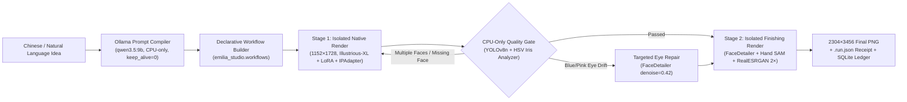

# Emilia Studio (v2.0)

**Emilia Studio** is a declarative, memory-disciplined SDXL character artwork pipeline built around ComfyUI and Ollama, specifically engineered to produce **2304×3456 refined anime illustrations** on constrained **8 GiB VRAM GPUs** (verified on NVIDIA CMP 40HX / Turing CC 7.5) without exhausting Windows system commit limits.

---

## Architecture Overview



### Key Features
- **Two-Stage Process Isolation for 8 GiB VRAM**: Separates `Stage 1` (`CLIP-ViT-H` + `IPAdapter Plus Face` + `FP32 Tiled VAE`) and `Stage 2` (`YOLOv8n` + `SAM ViT-B` + `FaceDetailer` + `DetailerForEach` + `RealESRGAN x4`) into sequential isolated processes so model weights never overlap in VRAM or Windows commit memory.
- **Zero-VRAM (CPU-Only) Quality Gate (`emilia_studio/inspector.py`)**: Runs deterministic YOLOv8n face/hand checks on CPU and analyzes HSV iris hue (`[250°, 302°]` violet band) to automatically catch multi-subject hallucinations and blue/pink heterochromia before spending compute on Stage 2 upscaling.
- **Declarative Workflow Builder (`emilia_studio/workflows.py`)**: Programmatically constructs `highres_native`, `highres_finish`, `eye_repair`, and `lora_native` graphs and synchronizes GUI workflows (`sync_visual_workflow`) with zero API/GUI parameter drift.
- **Bit-Exact Memory Optimizations (`emilia_runtime_patches`)**: Direct destination-buffer writes in `VAE.decode`/`VAE.encode`, feather-mask caching in `tiled_scale_multidim`, in-place `np.clip` quantization in `SaveImage`, 1 MiB streaming SHA-256 in `LoadImage`/`LoadLatent`, and `batch_prompt==1` copy elimination in `IPAdapter`. Verified bit-exact across 5 rounds × 10 seeds (50 full `2304×3456` renders).
- **SQLite Experiment Ledger (`emilia_studio/ledger.py`)**: Automatically indexes all `.run.json` receipts and benchmark rounds for instant CLI querying and cross-round pixel hash comparison.

---

## Repository Structure (Physical Isolation)

```text
.
├── emilia_studio/                 # Standalone studio package
│   ├── cli.py                     # Unified CLI (render, idea, inspect, ledger, workflows, setup)
│   ├── compiler.py                # Ollama Chinese-to-SDXL structured prompt compiler
│   ├── config.py                  # Auto-discovery & TOML/env configuration
│   ├── engine.py                  # Two-stage process-isolated rendering engine
│   ├── inspector.py               # CPU-only YOLOv8n + HSV violet-iris quality gate
│   ├── ledger.py                  # SQLite experiment & benchmark ledger
│   └── workflows.py               # Declarative API & GUI workflow builder
├── workflows/                     # All workflows & engineering decisions (tracked at top-level)
│   ├── api/                       # 27 canonical .api.json workflows
│   ├── visual/                    # 10 synchronized GUI workflows (Emilia_01..10)
│   ├── reports/                   # Historical benchmark & quality JSON reports
│   └── WORKFLOW_DECISIONS.txt     # Detailed technical decision record
├── patches/                       # Memory & allocation optimizations
│   ├── emilia_runtime_patches/    # Idempotent ComfyUI custom_node plugin
│   ├── comfyui_core.patch         # Git diff for comfy/sd.py, comfy/utils.py, nodes.py
│   └── ipadapter_plus.patch       # Git diff for CrossAttentionPatch.py
├── assets/                        # Reference conditioning assets
│   └── official_face_center_clean.png
├── tests/                         # Standalone & core unit test suites
│   ├── test_emilia_studio.py      # 9 architecture, workflow DSL, inspector & ledger tests
│   └── comfy_core/                # 4 VAE ownership, tiled blending, quantization & hash tests
├── AGENTS.md                      # Engineering, hardware, and architecture rules
├── PROGRESS.md                    # Chronological milestones & 50-image benchmark tables
├── config.example.toml            # Portable configuration template
├── models_manifest.json           # Required model weights, sizes, and custom node commits
├── ollama_comfyui_bridge.py       # Natural-language to SDXL bridge script
├── render-emilia-quality.ps1      # One-click PowerShell quality renderer
└── start-comfyui.ps1              # Interactive ComfyUI GUI launcher (port 8188)
```
*(Note: The local `app/` ComfyUI runtime directory is completely git-ignored at the top level so `app/.git` remains an untouched upstream ComfyUI repository.)*

---

## Quick Start

### 1. Configuration, Sync & Model Verification
Copy `config.example.toml` to `config.toml` (optional; paths auto-resolve by default), sync top-level workflows/patches/assets into `app/`, and verify your installed models against `models_manifest.json`:

```powershell
python -m emilia_studio.cli setup --sync
```

### 2. Render 2304×3456 Artwork (Fixed Seed or Auto-Gate)
```powershell
# Reproducible fixed-seed baseline (matches Round 1 SHA-256 pixel hash)
.\render-emilia-quality.ps1 -Seed 20261027

# Unattended mode with automatic multi-subject rejection & violet-iris repair gate
.\render-emilia-quality.ps1 -Seed 20261027 -AutoGate

# Optional PerturbedAttentionGuidance (PAG scale 1.0) composition variant
.\render-emilia-quality.ps1 -Seed 20261027 -Pag
```

### 3. Generate from Chinese Natural Language via Ollama
```powershell
# Default: 2-stage HighRes Quality (1152x1728 -> 2304x3456) with dynamic IPAdapter weight
python .\ollama_comfyui_bridge.py "爱蜜莉雅站在繁花盛开的石拱门下微笑，柔和阳光" --auto-gate

# Fast preview mode: single-stage 832x1216
python .\ollama_comfyui_bridge.py "爱蜜莉雅在雪地里提着灯笼" --mode fast
```

### 4. Inspect Images & Query Experiment Ledger
```powershell
# Run CPU-only anatomy & violet-iris inspection on any PNG
python -m emilia_studio.cli inspect app/output/emilia/quality/01_base_00060_.png --stage native

# View SQLite experiment statistics and verify Round 1 vs Round 5 pixel parity
python -m emilia_studio.cli ledger stats
python -m emilia_studio.cli ledger compare --round-a 1 --round-b 5
```

---

## Testing

```powershell
# Run the top-level Emilia Studio unit suite
python -m pytest tests/test_emilia_studio.py

# Run the full 148-test unit suite (including ComfyUI core tests)
python -m pytest app/tests-unit/comfy_test/
```

---

## License

- **Emilia Studio (`emilia_studio/`, root scripts, and documentation)**: MIT License (see [`LICENSE`](LICENSE)).
- **ComfyUI Runtime (`app/`)**: GPL-3.0 License (`app/LICENSE`).
- **Model Weights**: Subject to their respective upstream licenses (Illustrious-XL, RealESRGAN, Ultralytics YOLOv8, Segment Anything).
