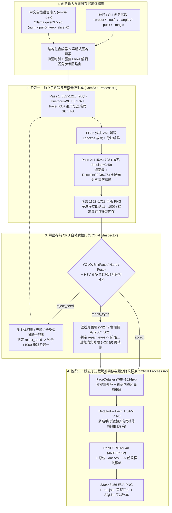
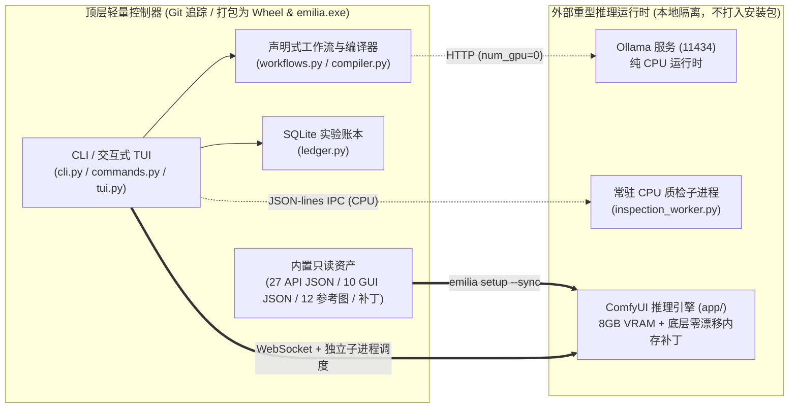

# Emilia Studio (v2.1)

<div align="center">

**简体中文 | [English](README.en.md)**

*专为 8 GiB 显存显卡打造的声明式 SDXL 角色精修编译器、双阶段物理隔离引擎与零显存质检自愈管线。*

</div>

---

## 项目简介

**Emilia Studio** 是一套围绕 **ComfyUI** 与 **Ollama** 从零构建的声明式、内存严苛受控的高分辨率动漫插画生成系统。项目针对 **8 GiB 显存显卡**（已在 NVIDIA CMP 40HX / Turing CC 7.5 上完整验证）与受限的 Windows 系统提交内存（Commit Limit）进行逐行热路径优化，稳定直出 **2304×3456 官图级精修角色插画**。

顶层控制器（`emilia_studio` Python 包及独立编译版 `emilia.exe`）仅包含调度逻辑、工作流构建器与参考图资产，与底层庞大的 ComfyUI/CUDA 推理环境（`app/`）完全物理隔离。

---

## 全局架构与运行管线

### 1. 端到端双阶段隔离渲染与自愈闭环



### 2. 控制器与外部推理环境物理隔离拓扑



---

## 核心技术特性

1. **三段式 Ultra 多尺度架构与服饰空间解耦（`emilia_studio/workflows.py`）**
   - **`832×1216`（锁骨骼与设定）$\to$ `1152×1728`（纯底模 + `RescaleCFG` 锁光影）$\to$ `2304×3456`（分部位精修 + 4× 超分 0.5× 抗锯齿降采样）**：显著减少 SDXL 直接生成高分辨率全身图常见的“长腿畸变”与“多肢体幻觉”；残余缺陷由 `--auto-gate` 质检门禁拦截。
   - **躯干软边空间掩码（`0.42W × 0.34H`）**：把王选礼服的“六道紫纹束腰 + 三层花瓣裙”参考限制在躯干区域，抑制袖口金鹰纹章串色到下摆燕尾。
   - **非官设服装路由（`--outfit frozen-bond / nightgown`）**：Stage 1 自动将 `lora_strength_base` 降至 `0.0` 并切换双角度正面/3/4侧面 `IPAdapter Plus Face` 锁脸，仅在 Stage 2 修脸时恢复 `lora_strength_finish=0.28`，抑制默认礼服束腰残留。
   - **图只由参数与配置决定**：构建器从不根据本机装了哪些模型改写工作流；缺少 LoRA、IPAdapter 或参考图时由 ComfyUI 校验直接报错，而不是悄悄换一张图。
2. **面向 8 GiB 显存的双阶段进程物理隔离与批量复用池（`emilia_studio/engine.py`）**
   - Stage 1（`CLIP-ViT-H` + 双 `IPAdapter`）与 Stage 2（`YOLO` + `SAM ViT-B` + `RealESRGAN`）总权重超过 12 GB，严禁同进程驻留。Stage 1 落盘后子进程立即退出清空显存与 Windows 提交内存，Stage 2 通过 `[output]` 零拷贝引用直接接力。
   - 单张（`emilia render`）与批量（`emilia batch`）是同一条管线：全部种子的 Stage 1（含门禁重试）$\to$ CPU 质检门禁 $\to$ 全部种子的 Stage 2（修眼 + 精修），$N$ 张图始终只有 $2$ 次模型冷启动。
   - 每个种子在完成或被拒绝的那一刻就写出 `.run.json` 回执（与图片同目录）并入账本；后续种子崩溃不会丢掉已有结果。
   - 每张图有独立执行期限（`stage_timeout_s=900`，覆盖连接、提交、执行和历史结果读取）与当前任务事件静默期限（`stall_timeout_s=300`）。超时会退出并回收所启动的 ComfyUI 子进程；不会停止已占用端口上的外部服务。可在 TOML `[services]` 或环境变量 `EMILIA_STAGE_TIMEOUT_S` / `EMILIA_STALL_TIMEOUT_S` 中设置；非正数禁用对应期限。
   - 无界面 `SaveImage` 对文件名前缀为 `01_`、`02_`、`eye_repair_` 的中间 PNG 使用零压缩，其余保留原压缩策略；只改变文件大小，不改变解码像素。并非内存盘或跨进程张量直传。
3. **零显存（纯 CPU）解剖学、站姿与紫罗兰虹膜自愈门禁（`emilia_studio/inspector.py`）**
   - 强制在 CPU 上运行 `face_yolov8n`、`hand_yolov8n` 与 `yolov8n-pose`：自动拦截单人多脸幻觉、缺脸，以及全身构图（`full_body`）下的跪坐/裁脚缺陷（`reject_seed`）。
   - **HSV 虹膜环形色相分析**：计算双瞳环形均值色相角，捕捉“一蓝一粉异色瞳”（色差 $>32^\circ$）或偏离紫罗兰色带（$[250^\circ, 302^\circ]$）的漂移，并在 Stage 2 进程内先执行修眼（`repair_eyes`，约 `22 秒`）再精修。
   - **定位与局限**：复用 CPU YOLO 的 COCO 眼部关键点约束候选虹膜区域；关键点不可靠时退回显式人脸几何先验。候选提取限制在至多 `384×384` 工作图；色彩仍在原图像素上测量。它不是专用动漫五官模型，也没有经过标注数据集精度评估；小型发饰、暖红色虹膜、遮挡或微小眼睛仍可能无法可靠辨认。未测量眼睛记为 `eye_color_verified=false`，既不算紫瞳也不因缺测触发修眼。修眼后仍须重新质检，不通过则禁止放大。
4. **12 项 Bit-Exact 像素级零漂移底层硬件榨取补丁（`patches/` & `engine.py`）**
   - **GPU/PCIe 热路径**：IPAdapter 跨步 `(ip_k, ip_v)` 线性投影缓存（消除 **15,000+** 次冗余 CUDA 核启动）、空间注意力掩码 `[B, S, 1]` 广播缓存（消除 `1,960` 次 `F.interpolate` 与 `1280×` `.repeat()` 显存膨胀）、`CLIPVision` 零图像负向特征缓存、每步 `sigma` 标量缓存（消除 **2,484 次** GPU$\to$CPU 同步停顿）、`SAM ViT-B` `meta + mmap + assign` 零初始化加载（提速 **6.0×**，省 `750 MiB` 峰值内存）及特征缓存（提速 50%）。
   - **CPU/内存/启动热路径**：256 行 L3 缓存分块多线程 `float32 <-> uint8` 量化（提速 **3.3×**，消除 `lanczos` `382.2 MiB` 与 `SaveImage` `91.1 MiB` 临时浮点拷贝）、`VAE` 目标缓冲区直写与 `tiled_scale_multidim` 掩码复用（省 `676.8 MiB`）、`ImageUpscaleWithModel` 按分块上 GPU（省 `382.21 MiB`）、静态 PNG 免 PyAV 直读、分阶段插件白名单与精简 `comfy_extras` 冷启动（省 `17.3s`）、`<1ms` 独占端口检测 + 日志驱动零重试就绪握手、Stage 1 期间后台异步预热 CPU YOLO 与进程回收并行质检（消除 `8.8s` 门禁冷启动等待）。
   - 经固定种子 `20261027`（`quality` 与 `ultra` 全流程 `2304×3456` 大图）及历史 50 图基准严格验证，解码像素 SHA-256 **100% 逐字节一致**。

---

## 快速开始

### 1. 安装与初始化环境

```powershell
# 在推理或控制环境中安装 Emilia Studio
python -m pip install -e .

# 初始化用户配置（保存至 %APPDATA%\EmiliaStudio\config.toml）
emilia config init --root-dir <工作区> --app-dir <工作区>/app --python <推理环境>/python.exe

# 首次部署：把 ComfyUI 与三个自定义节点检出到 models_manifest.json 记录的 commit，再应用源码补丁
git -C app checkout 0a33ed6c28f926d14536235771c222f9e6d1026b
git -C app apply ../patches/comfyui_core.patch
git -C app/custom_nodes/comfyui-ipadapter-plus apply ../../../patches/ipadapter_plus.patch
git -C app/custom_nodes/comfyui-impact-pack apply ../../../patches/impact_pack.patch
git -C app/custom_nodes/comfyui-impact-subpack apply ../../../patches/impact_subpack.patch

# 将顶层参考图、补丁插件与可视化工作流同步至 app/，再体检（含各检出的 commit 与补丁是否已应用）
emilia setup --sync
emilia doctor

# 按需查看或断点续传下载缺失模型（支持 required 与 experimental 模型分级）
emilia pull --list
```

*无参数直接运行 `emilia` 将展示渐变 ASCII 欢迎页并进入交互式命令终端（支持输入 `help <子命令>` 查看详情，`exit` 退出）。*

### 2. 生成 2304×3456 精修插画

```powershell
# 1. 使用内置场景预设 + Ultra 多尺度精修 + 自动质检门禁
emilia render --profile ultra --preset rose-garden --auto-gate

# 2. 组合创意参数：5 套专属服装 / 视角锁定 / 帕克伴随 / 冰魔法特效
emilia render --profile ultra --preset moonlit-balcony --outfit nightgown --angle three-quarter --puck --magic ice --auto-gate

# 3. 中文自然语言一键编译并直通双阶段高分管线（Ollama 纯 CPU 编译）
emilia idea "爱蜜莉雅站在飘雪的月光庭院里微笑，双手轻捧冰晶花" --outfit cloak --magic blizzard --auto-gate

# 4. 多图同阶段进程池连抽（模型零重复加载）
emilia batch --seeds 20261113 20261114 20261115 --profile ultra --preset rose-garden --auto-gate

# 5. 开启极速 TensorCore 模式（FP16 超分 + FP16-Fix VAE + 单轮分块 VAE + 精简步数，单张 ~213s）
emilia render --profile quality --seed 20261027 --fast

# 6. 固定种子像素一致性基准复现（或使用 PowerShell 快捷脚本，支持 -Fast）
.\render-emilia-quality.ps1 -Seed 20261027 -Profile quality
```

#### 可选：8 步构图预览（非生产成片）

```powershell
emilia pull sdxl-lightning-8step-unet
emilia setup --sync
emilia render --profile ultra --preset rose-garden --preview
# 同样支持 batch / idea；PowerShell 快捷脚本使用 -Preview
```

预览使用 [ByteDance 官方 SDXL-Lightning](https://huggingface.co/ByteDance/SDXL-Lightning) 独立 8 步 UNet（约 `5.14 GB`，在 D: 工作区时下载到该工作区，不随发行包携带），固定 `Euler / sgm_uniform / CFG 1`，默认输出 `832×1216`。只加载生产检查点的 CLIP/VAE，不实例化它的 UNet；跳过 hires、修眼、精修与超分。它是**纯文本构图草稿**：服装/视角是文本提示，不加载 Emilia LoRA 或 IPAdapter，因此不保证人物身份或与生产档同种子同构图。CFG 1 下负面提示不参与引导。

缺少模型会提示安装，不会悄悄换模型或 VAE。`--steps` 只能是 `8`；不兼容 `--fast`、`--pag`、`--reference-mode` 和 Stage 2/hires 参数。`--fp16-vae` / `--fast-tiled-vae` 须显式选择。`--auto-gate` 可以拒绝或重抽有问题的预览；需要修眼时报告拒绝，不会在单阶段预览里偷偷启动 Stage 2。不要把预览当成画质或身份一致性验收。

### 3. 质检对比、成品导出与实验账本

```powershell
# 对任意图像执行纯 CPU 解剖学、全身姿态、紫瞳色相与四角水印体检
emilia inspect app/output/emilia/ultra/03_finished_2x_00015_.png --stage final

# 对比两张成品 PNG 或 .run.json 回执的 SHA-256、双瞳色相角与异色瞳评分
emilia compare app/output/emilia/ultra/03_finished_2x_00013_.png app/output/emilia/ultra/03_finished_2x_00015_.png

# 将最新成品图、阶段一母版、回执与工作流打包导出至指定目录
emilia export ./deliverables

# 查询 SQLite 实验账本历史统计与基准耗时，清理 temp/ 阶段临时目录
emilia ledger stats
emilia benchmark --limit 10
emilia clean --older-than-hours 1.0
```

---

## CLI 命令速查表

| 子命令 | 功能说明 |
| :--- | :--- |
| `config init / show / set / path` | 初始化、查看或修改 TOML 配置（优先级：`EMILIA_*` 环境变量 > `--config` > 用户全局配置 > 源码目录配置） |
| `doctor` / `setup --sync` | 校验 Python、依赖、模型权重（`required` / `experimental`）、参考图、插件，以及 ComfyUI 与自定义节点的 commit 和补丁状态；将资产与补丁插件同步至 `app/` |
| `pull --list / <key> / all` | 支持 HTTP Range 断点续传、`.part` 原子替换与 SHA-256 校验的模型下载器（未知源的 LoRA 打印手动指引） |
| `presets [name]` / `outfits [name]` | 浏览 6 套免 Ollama 内置场景预设与 5 套专属服装模式（`royal` / `cloak` / `frozen-bond` / `sanctuary` / `nightgown`） |
| `render` / `batch` / `idea` | 单张渲染、同阶段进程池批量连抽、中文编译渲染（支持 `--fast`、`--fp16-upscaler`、`--fp16-vae`、`--fast-tiled-vae`、`--steps` 等加速参数）。退出码：`0` 成功，`2` 被质检门禁拒绝，`1` 执行失败 |
| `inspect` / `compare` | 纯 CPU 单图全面体检；双图分辨率、像素哈希与双瞳色相指标并排对比 |
| `export` / `clean` | 打包导出完整交付物；安全清理已结束的隔离阶段临时目录 |
| `ledger` / `benchmark` / `workflows` | 查询 SQLite 实验账本与跨轮次像素比对；汇总历史基准；审计 API 工作流目录并从构建器重新同步 GUI 工作流 |
| `shell` / `banner` / `--version` | 启动交互式 REPL 命令行、打印终端标志或查看版本号 |

---

## 仓库目录结构

```text
.
├── emilia_studio/                 # 顶层独立 Studio 核心包（打包进 Wheel 与 emilia.exe）
│   ├── cli.py                     # CLI 参数解析与全子命令路由入口
│   ├── commands.py                # config / doctor / pull / presets / outfits / compare / export / clean 实现
│   ├── compiler.py                # Ollama 中文转 SDXL 编译器与构图/服饰正负词合成器
│   ├── config.py                  # 环境自发现、TOML 配置加载与爱蜜莉雅服装/场景常量库
│   ├── engine.py                  # 双阶段物理隔离渲染引擎与同阶段批量复用进程池
│   ├── inspector.py               # 纯 CPU 解剖学、姿态完整性、HSV 紫瞳色相与水印诊断门禁
│   ├── inspection_worker.py       # 供独立 exe 调用的常驻 JSON-lines 外部 CPU YOLO 服务进程
│   ├── ledger.py                  # WAL 模式 SQLite 实验与基准账本管理
│   ├── tui.py                     # 渐变 ASCII 标志、CJK 宽字符对齐表格与实时进度条
│   └── workflows.py               # API 图构建器（quality 图基于 JSON 模板，ultra 图由代码生成）与 GUI 工作流同步器
├── assets/                        # 官方设定条件控制参考图（正面/3/4脸、胸衣裙摆、领口胸针等）
├── workflows/                     # 工作流与实验档案
│   ├── api/                       # 构建器加载的 4 个模板、ultra 规范快照，以及历史实验 .api.json
│   ├── visual/                    # 同步后的 ComfyUI 网页端可视化工作流 (Emilia_01..10)
│   ├── reports/                   # 历史架构消融、画质评估与硬件解锁实验报告 JSON
│   └── WORKFLOW_DECISIONS.txt     # 完整工程决策与像素哈希演进档案
├── patches/                       # 底层零漂移内存与硬件极限加速补丁
│   ├── emilia_runtime_patches/    # 自校验 ComfyUI Custom Node 运行时热补丁 + EmiliaRelativeGarmentSEGS 节点
│   ├── comfyui_core.patch         # 针对 main.py, comfy/sd.py, utils.py, caching.py, execution.py, nodes.py 的补丁
│   ├── ipadapter_plus.patch       # 针对 CrossAttentionPatch.py 与 IPAdapterPlus.py 的 KV/掩码/sigma/uncond 缓存补丁
│   ├── impact_pack.patch          # 针对 SAMLoader (meta+mmap+assign) 与 SAMWrapper 特征缓存的补丁
│   └── impact_subpack.patch       # 针对 subcore.py 免冗余灰度拷贝与静默推理的补丁
├── packaging/                     # PyInstaller 独立 Windows 可执行文件构建脚本与规范 (emilia.spec)
├── scripts/                       # 10 种子基准轮次的运行与评估脚本、启动器共用的 Python 解析函数
├── tests/                         # 顶层单测模块及 comfy_core/ 底层算子测试
├── AGENTS.md                      # 硬件红线、进程隔离规则与像素一致性工程规范
├── PROGRESS.md                    # 完整研发里程碑与实测数据台账
├── build_support.py               # Wheel 与 PyInstaller 构建期只读资源自动归集器
├── config.example.toml            # 可移植 TOML 配置模板
├── models_manifest.json           # 模型权重、参考图清单，以及 ComfyUI 与自定义节点的 commit 和补丁
├── gpu_profile.py                 # CMP 40HX 功耗/风扇/时钟偏移配置（可选；超频会影响可复现性的排查）
├── install-gpu-profile-task.ps1   # 以 SYSTEM 计划任务常驻上述配置；注册前审计被执行路径的 ACL
├── ollama_comfyui_bridge.py       # 轻量中文自然语言生图桥接脚本 (--mode ultra / quality / fast)
├── render-emilia-quality.ps1      # `emilia render` 的 PowerShell 快捷启动器
└── start-comfyui.ps1              # PowerShell ComfyUI 网页端 GUI 启动器 (默认 127.0.0.1:8188)
```

*注：本地 `app/`（ComfyUI 运行时与自定义节点）在 `.gitignore` 中整目录忽略。它不是干净的上游检出：`patches/*.patch` 修改了其中已跟踪的源码，基线 commit 记录在 `models_manifest.json`，`emilia doctor` 会校验 commit 与补丁状态；升级 ComfyUI 或自定义节点后必须重新生成对应补丁。*

### 可选 GPU 计划任务：管理员安装与安全边界

旧的 SYSTEM 任务若直接执行可写的仓库脚本/Conda 解释器，存在本地提权风险。新版安装器不锁死开发目录，而是在 `%ProgramData%\EmiliaGPUProfile\versions\` 下创建受保护的版本化 Python/pynvml 副本，固定导入路径并使用 `-I -S`。旧版本保留至卸载，以免破坏仍在运行的任务。

```powershell
# 在管理员 PowerShell 中执行；普通终端可以执行 -Audit
.\install-gpu-profile-task.ps1 -Python D:\conda-data\envs\comfyui\python.exe
.\install-gpu-profile-task.ps1 -Audit
# 卸载（管理员）；GPU 参数复位为尽力而为，不要求依赖仍然完整
.\install-gpu-profile-task.ps1 -Remove
```

`-Audit` 检查实际注册的任务及依赖，不只是源码中的计划配置。`-AllowUserWritable` 是不安全的显式绕过，审计仍会失败。升级会创建新副本；修改仓库脚本后必须重新安装才能更新 SYSTEM 执行的副本。当前会话的 UAC 请求被取消，**本机旧任务尚未迁移**；源码修改本身不会消除已有风险。


---

## 从源码构建与运行测试

```powershell
# 构建跨目录可移植 Wheel 包与独立 Windows 控制台程序 (dist/emilia.exe)
python -m pip install ".[build]"
powershell -NoProfile -ExecutionPolicy Bypass -File packaging/build_windows.ps1 -Python <推理环境>/python.exe

# 运行顶层 Emilia Studio 单元测试（不需要 GPU；缺少 app/ 或 torch 时相关用例自动跳过）
python -m pytest tests/

# 运行 ComfyUI 运行时底层算子与全量单元测试（需要推理环境与 app/）
python -m pytest app/tests-unit/comfy_test/
```

---

## 开源协议

- **Emilia Studio 控制器、工作流、补丁与测试（`emilia_studio/`, `workflows/`, `patches/`, `tests/`, `packaging/`）**：[MIT License](LICENSE)。
- **外部 ComfyUI 运行时（`app/`）**：GPL-3.0 License。
- **预训练模型权重**：遵循各上游模型发布协议（Illustrious-XL、RealESRGAN、Ultralytics YOLOv8、Segment Anything）。
