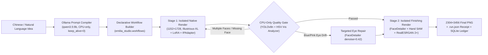
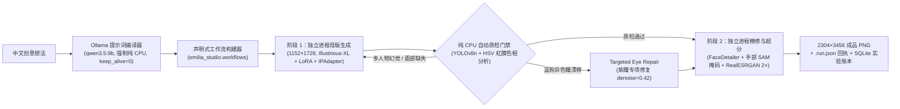

# Emilia Studio (v2.1)

<div align="center">

**[English](#english) | [简体中文](#简体中文)**

*A declarative, memory-disciplined SDXL character artwork pipeline & quality-gate engine for 8 GiB VRAM GPUs.*  
*专为 8GB 显存显卡打造的声明式 SDXL 角色精修管线与自动质检闭环引擎。*

</div>

---
## CLI application / 命令行应用

The CLI ships as a Python wheel (`emilia`, `emilia-studio`) and a Windows console executable (`emilia.exe`). These contain the controller and reference/workflow resources, **not** ComfyUI, CUDA, model weights or Ollama. Keep those in a separate inference environment. The frozen controller invokes the configured Python for CPU YOLO inspection; it does not load GPU models itself.

```powershell
python -m pip install .
emilia config init --root-dir D:/comfyui --app-dir D:/comfyui/app --python D:/conda-data/envs/comfyui/python.exe
emilia doctor
emilia setup --sync
emilia
```

无参数启动显示由 `/`、`\`、`_`、`--` 组成的 EMILIA 标志，并在交互终端进入命令提示符；输入 `help` 查看帮助，`exit` 退出。重定向输入时只显示欢迎页，不等待输入。直接子命令不会插入欢迎图案，原有 JSON 查询输出保持可解析。

| Command | Behavior |
| --- | --- |
| `config init/show/set/path` | 保存、查看和修改用户 TOML 配置；`init --force` 才覆盖已有文件 |
| `doctor` | 检查 ComfyUI、推理 Python、依赖、模型大小、参考图和节点目录；缺失时返回非零 |
| `pull --list` / `pull yolo-face` / `pull all` | 列出或下载模型，显示字节、速度和 ETA；支持断点续传和可用 SHA256 校验 |
| `presets` / `presets rose-garden` | 列出场景或打印完整提示词，无需调用 Ollama |
| `render --profile ultra --preset rose-garden` | 用预设执行真实两阶段渲染，显示采样进度 |
| `idea "爱蜜莉雅在月光下的花园"` | CPU Ollama 编译提示词后渲染 |
| `gallery --limit 10` / `gallery --open 1` | 浏览最近 PNG，按显示序号打开图片 |
| `banner` / `shell` / `--version` | 欢迎图案、交互命令行、版本 |

配置优先级：字段环境变量 > `--config` / `EMILIA_CONFIG_TOML` 指定文件 > 用户配置 > 源码目录配置。用户配置位于 Windows `%APPDATA%/EmiliaStudio/config.toml`，其他平台使用 XDG 配置目录。`EMILIA_CONFIG_DIR` 可覆盖用户配置目录。相对 TOML 路径以文件所在目录为基准。安装包资源与可写工作目录分离；不会把任意当前目录的 `config.toml` 当作配置。

下载写入 `.part`，长度及可用 SHA256 校验通过后才替换目标。失败保留已有目标；重新运行同一命令续传。两个 Emilia LoRA 的旧下载 ID 无法确认，**不会自动下载猜测版本**；`pull` 会打印手动安装说明并返回非零。`doctor` 的大小检查不是完整校验和审计，也不证明 GPU 渲染成功。

Build from source:

```powershell
python -m pip install ".[build]"
python -m build
powershell -File packaging/build_windows.ps1 -Python D:/conda-data/envs/comfyui/python.exe
```

Wheel/exe can be launched from another directory after configuring the external runtime. Rebuild resources from their top-level source on each build; do not edit generated package resource copies.


<a id="english"></a>

## 🌐 English

**Emilia Studio** is a declarative, memory-disciplined SDXL character artwork pipeline built around ComfyUI and Ollama, specifically engineered to produce **2304×3456 refined anime illustrations** on constrained **8 GiB VRAM GPUs** (verified on NVIDIA CMP 40HX / Turing CC 7.5) without exhausting Windows system commit limits.

### Architecture Overview



### Key Features

- **Two-Stage Process Isolation for 8 GiB VRAM**: Separates `Stage 1` (`CLIP-ViT-H` + `IPAdapter Plus Face` + `FP32 Tiled VAE`) and `Stage 2` (`YOLOv8n` + `SAM ViT-B` + `FaceDetailer` + `DetailerForEach` + `RealESRGAN x4`) into sequential isolated processes so model weights never overlap in VRAM or Windows commit memory.
- **Zero-VRAM (CPU-Only) Quality Gate (`emilia_studio/inspector.py`)**: Runs deterministic YOLOv8n face/hand checks on CPU and analyzes HSV iris hue (`[250°, 302°]` violet band) to automatically catch multi-subject hallucinations and blue/pink heterochromia before spending compute on Stage 2 upscaling.
- **Declarative Workflow Builder (`emilia_studio/workflows.py`)**: Programmatically constructs `highres_native`, `highres_finish`, `eye_repair`, and `lora_native` graphs and synchronizes GUI workflows (`sync_visual_workflow`) with zero API/GUI parameter drift.
- **Bit-Exact Memory Optimizations (`patches/`)**: Direct destination-buffer writes in `VAE.decode`/`VAE.encode`, feather-mask caching in `tiled_scale_multidim`, in-place `np.clip` quantization in `SaveImage`, 1 MiB streaming SHA-256 in `LoadImage`/`LoadLatent`, and `batch_prompt==1` copy elimination in `IPAdapter`. Verified bit-exact across 5 rounds × 10 seeds (50 full `2304×3456` renders).
- **SQLite Experiment Ledger (`emilia_studio/ledger.py`)**: Automatically indexes all `.run.json` receipts and benchmark rounds for instant CLI querying and cross-round pixel hash comparison.

### Repository Structure (Physical Isolation)

```text
.
├── emilia_studio/                 # Standalone studio package (Primary Ownership)
│   ├── cli.py                     # Unified CLI (render, idea, inspect, ledger, workflows, setup)
│   ├── compiler.py                # Ollama Chinese-to-SDXL structured prompt compiler
│   ├── config.py                  # Auto-discovery & TOML/env configuration
│   ├── engine.py                  # Two-stage process-isolated rendering engine
│   ├── inspector.py               # CPU-only YOLOv8n + HSV violet-iris quality gate
│   ├── ledger.py                  # SQLite experiment & benchmark ledger
│   └── workflows.py               # Declarative API & GUI workflow builder
├── workflows/                     # All workflows & engineering decisions (tracked at top-level)
│   ├── api/                       # 27 canonical .api.json workflows
│   ├── visual/                    # 10 synchronized GUI workflows (Emilia_01..10)
│   ├── reports/                   # Historical benchmark & quality JSON reports
│   └── WORKFLOW_DECISIONS.txt     # Detailed technical decision record
├── patches/                       # Memory & allocation optimizations
│   ├── emilia_runtime_patches/    # Idempotent ComfyUI custom_node plugin
│   ├── comfyui_core.patch         # Git diff for comfy/sd.py, comfy/utils.py, nodes.py
│   └── ipadapter_plus.patch       # Git diff for CrossAttentionPatch.py
├── assets/                        # Reference conditioning assets
│   └── official_face_center_clean.png
├── tests/                         # Standalone & core unit test suites
│   ├── test_emilia_studio.py      # 9 architecture, workflow DSL, inspector & ledger tests
│   └── comfy_core/                # 4 VAE ownership, tiled blending, quantization & hash tests
├── AGENTS.md                      # Engineering, hardware, and architecture rules
├── PROGRESS.md                    # Chronological milestones & 50-image benchmark tables
├── config.example.toml            # Portable configuration template
├── models_manifest.json           # Required model weights, sizes, and custom node commits
├── ollama_comfyui_bridge.py       # Natural-language to SDXL bridge script
├── render-emilia-quality.ps1      # One-click PowerShell quality renderer
└── start-comfyui.ps1              # Interactive ComfyUI GUI launcher (port 8188)
```
*(Note: The local `app/` ComfyUI runtime directory is completely git-ignored at the top level so `app/.git` remains an untouched upstream ComfyUI repository.)*

### Quick Start

#### 1. Configuration, Sync & Model Verification
Copy `config.example.toml` to `config.toml` (optional; paths auto-resolve by default), sync top-level workflows/patches/assets into `app/`, and verify your installed models against `models_manifest.json`:

```powershell
python -m emilia_studio.cli setup --sync
```

#### 2. Render 2304×3456 Artwork (Ultra Multi-Scale or Bit-Exact Baseline)
```powershell
# Recommended: Next-Gen Ultra Multi-Scale Hires.fix (832x1216 -> 1152x1728 -> 2304x3456) with canonical outfit lock
.\render-emilia-quality.ps1 -Seed 20261027 -Profile ultra -AutoGate

# Reproducible fixed-seed baseline (matches Round 1 SHA-256 pixel hash)
.\render-emilia-quality.ps1 -Seed 20261027 -Profile quality

# Optional PerturbedAttentionGuidance (PAG) composition variant
.\render-emilia-quality.ps1 -Seed 20261027 -Pag
```

#### 3. Generate from Chinese Natural Language via Ollama
```powershell
# Default: 2-stage HighRes Quality (1152x1728 -> 2304x3456) with dynamic IPAdapter weight
python .\ollama_comfyui_bridge.py "爱蜜莉雅站在繁花盛开的石拱门下微笑，柔和阳光" --auto-gate

# Fast preview mode: single-stage 832x1216
python .\ollama_comfyui_bridge.py "爱蜜莉雅在雪地里提着灯笼" --mode fast
```

#### 4. Inspect Images & Query Experiment Ledger
```powershell
# Run CPU-only anatomy & violet-iris inspection on any PNG
python -m emilia_studio.cli inspect app/output/emilia/quality/01_base_00060_.png --stage native

# View SQLite experiment statistics and verify Round 1 vs Round 5 pixel parity
python -m emilia_studio.cli ledger stats
python -m emilia_studio.cli ledger compare --round-a 1 --round-b 5
```

#### 5. Testing
```powershell
# Run the top-level Emilia Studio unit suite
python -m pytest tests/test_emilia_studio.py

# Run the full 148-test unit suite (including ComfyUI core tests)
python -m pytest app/tests-unit/comfy_test/
```

---

<a id="简体中文"></a>

## 🇨🇳 简体中文

**Emilia Studio** 是一套围绕 ComfyUI 与 Ollama 构建的声明式、内存严苛受控的 SDXL 角色精修生图管线。它专门针对 **8 GiB 显存显卡**（已在 NVIDIA CMP 40HX / Turing CC 7.5 上完整验证）与受限的 Windows 系统提交内存（Commit Limit）进行深度工程优化，能够稳定直出 **2304×3456 商业级精修动漫插画**。

### 架构总览



### 核心特性

- **面向 8 GiB 显存的双阶段进程物理隔离**：将 `Stage 1`（`CLIP-ViT-H` + `IPAdapter Plus Face` + `FP32 分块 VAE`）与 `Stage 2`（`YOLOv8n` + `SAM ViT-B` + `FaceDetailer` + `DetailerForEach` + `RealESRGAN x4`）拆分为串行独立子进程。Stage 1 完成后彻底退出并释放全部显存与系统虚拟内存，再启动 Stage 2，根绝模型共驻导致的 OOM 崩溃。
- **零显存（纯 CPU）自动质检门禁（`emilia_studio/inspector.py`）**：在母版进入耗时的超分阶段前，强制在 CPU 上运行 YOLOv8n 人脸/手部检测与 HSV 眼部环形色相分析（锁定 $[250^\circ, 302^\circ]$ 紫罗兰色相带），自动拦截单人 Prompt 下的多主体幻觉（`reject_seed`）以及“一蓝一粉异色瞳”缺陷（自动触发 `eye_repair` 分支自愈）。
- **声明式工作流构建器（`emilia_studio/workflows.py`）**：用类型安全的 Python 代码构建 `highres_native`、`highres_finish`、`eye_repair`、`lora_native` 四大工作流，并通过 `sync_visual_workflow()` 自动将参数同步至 ComfyUI GUI 可视化工作流，彻底消灭 API 与 GUI 参数漂移（如 `noise_mask_feather`）。
- **100% 像素级一致（Bit-Exact）底层内存优化（`patches/`）**：包含 `VAE.decode`/`VAE.encode` 目标缓冲区直写、`tiled_scale_multidim` 分块羽化掩码缓存、`SaveImage` 原位 `np.clip` 量化（单张 2304×3456 节省 91.1 MiB 临时浮点数组）、`LoadImage`/`LoadLatent` 1 MiB 流式 SHA-256 哈希以及 `IPAdapter` batch-1 免拷贝补丁。经 **5 轮 × 10 个固定种子（共 50 张 2304×3456 大图）** 严苛验证，解码像素 SHA-256 与基线 100% 一致。
- **Ollama 中文结构化编译与 SQLite 实验账本**：`OllamaPromptCompiler` 支持将中文自然语言编译为 Danbooru 标签，并根据“全身/半身/特写”自动路由 IPAdapter 权重（0.40 / 0.45 / 0.50），全程强制 `num_gpu=0, keep_alive=0`；`ExperimentLedger` 将所有历史运行回执与基准测试自动归档至 SQLite，支持命令行一键统计与跨轮次比对。

### 仓库目录结构（顶层物理隔离模式）

```text
.
├── emilia_studio/                 # 顶层独立 Studio 核心包
│   ├── cli.py                     # 统一命令行入口 (render, idea, inspect, ledger, workflows, setup)
│   ├── compiler.py                # Ollama 中文转 SDXL 结构化提示词编译器
│   ├── config.py                  # 环境自发现 (自动探测 Conda / Ollama) 与配置管理
│   ├── engine.py                  # 双阶段进程隔离渲染引擎
│   ├── inspector.py               # 纯 CPU YOLOv8n + HSV 紫瞳/异色瞳质检门禁
│   ├── ledger.py                  # SQLite 实验与基准账本管理
│   └── workflows.py               # 声明式 API 与 GUI 工作流构建器
├── workflows/                     # 顶层追踪的全部工作流与技术决策档案
│   ├── api/                       # 27 个标准 .api.json 工作流定义
│   ├── visual/                    # 10 个同步后的 ComfyUI 可视化工作流 (Emilia_01..10)
│   ├── reports/                   # 历史性能、画质与社区节点实验报告 JSON
│   └── WORKFLOW_DECISIONS.txt     # 完整工程决策与实验记录
├── patches/                       # 底层内存与分配优化补丁
│   ├── emilia_runtime_patches/    # 幂等 ComfyUI Custom Node 运行时优化插件
│   ├── comfyui_core.patch         # 针对 comfy/sd.py, comfy/utils.py, nodes.py 的标准 git diff
│   └── ipadapter_plus.patch       # 针对 CrossAttentionPatch.py 的标准 git diff
├── assets/                        # 官方参考图资产
│   └── official_face_center_clean.png
├── tests/                         # 顶层独立测试套件与底层算子测试
│   ├── test_emilia_studio.py      # 9 项架构、工作流 DSL、质检门禁与账本测试
│   └── comfy_core/                # 4 项 VAE 所有权、分块混合、原位量化与流式哈希测试
├── AGENTS.md                      # 项目工程规范、8GB 显存红线与像素一致性契约
├── PROGRESS.md                    # 6 阶段完整研发演进台账与 50 张大图基准表
├── config.example.toml            # 可移植配置模板
├── models_manifest.json           # 8 个必需模型权重、参考图尺寸与 4 个插件版本锁清单
├── ollama_comfyui_bridge.py       # 中文自然语言转 SDXL 生图桥接脚本
├── render-emilia-quality.ps1      # PowerShell 一键高画质渲染启动器
└── start-comfyui.ps1              # PowerShell ComfyUI GUI 交互式启动器 (8188 端口)
```
*（注：本地 `app/` ComfyUI 运行时目录已在 `.gitignore` 中整目录忽略，确保 `app/.git` 保持为纯净的上游官方 ComfyUI 仓库。）*

### 快速上手

#### 1. 环境校验与资源同步
可选将 `config.example.toml` 复制为 `config.toml`（默认会自动探测路径），执行以下命令将顶层工作流、补丁与参考图同步进 `app/`，并校验全部 8 个模型权重与 4 个插件：

```powershell
python -m emilia_studio.cli setup --sync
```

#### 2. 运行 2304×3456 高画质渲染（Ultra 多尺度精修或基准复现模式）
```powershell
# 推荐：新一代 Ultra 多尺度 Hires.fix 模式（832x1216 -> 1152x1728 全身精修 -> 2304x3456，锁定原版露肩分离领礼服与自然全身比例）
.\render-emilia-quality.ps1 -Seed 20261027 -Profile ultra -AutoGate

# 固定种子可复现基准模式（输出像素 SHA-256 与 Round 1 100% 一致）
.\render-emilia-quality.ps1 -Seed 20261027 -Profile quality

# 可选开启社区 PAG (PerturbedAttentionGuidance) 构图变体
.\render-emilia-quality.ps1 -Seed 20261027 -Pag
```

#### 3. 中文自然语言一键生图（Ollama 桥接）
```powershell
# 默认模式：编译中文创意并直通 1152x1728 -> 2304x3456 双阶段精修超分管线
python .\ollama_comfyui_bridge.py "爱蜜莉雅站在繁花盛开的石拱门下微笑，柔和阳光" --auto-gate

# 快速预览模式：单阶段 832x1216 快速生图
python .\ollama_comfyui_bridge.py "爱蜜莉雅在雪地里提着灯笼" --mode fast
```

#### 4. 图像独立质检与 SQLite 实验账本查询
```powershell
# 对任意已生成的 PNG 执行纯 CPU 解剖学与紫罗兰虹膜色相体检
python -m emilia_studio.cli inspect app/output/emilia/quality/01_base_00060_.png --stage native

# 查看 SQLite 实验账本全局统计，并对比第 1 轮与第 5 轮的 10 个种子像素一致性
python -m emilia_studio.cli ledger stats
python -m emilia_studio.cli ledger compare --round-a 1 --round-b 5
```

#### 5. 运行单元测试
```powershell
# 运行顶层 Emilia Studio 架构测试套件
python -m pytest tests/test_emilia_studio.py

# 运行包含 ComfyUI 底层算子在内的全量 148 项单元测试
python -m pytest app/tests-unit/comfy_test/
```

---

## License / 开源协议

- **Emilia Studio (`emilia_studio/`, `workflows/`, `patches/`, `tests/`, root scripts & docs)**: MIT License (see [`LICENSE`](LICENSE)).
- **ComfyUI Runtime (`app/`)**: GPL-3.0 License (`app/LICENSE`).
- **Model Weights**: Subject to their respective upstream licenses (Illustrious-XL, RealESRGAN, Ultralytics YOLOv8, Segment Anything).
